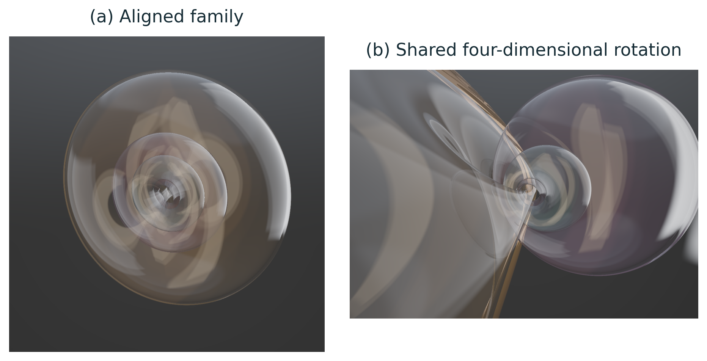

## Abstract

We present a browser-based renderer for stereographic projections of rotated Hopf tori, including solid regions and thin angular shells. A rank-two projector supplies implicit quartic intersections and analytic normals. The implementation study provides a homogeneous construction of bounded ray charts for surfaces passing through infinity, a workflow separating numerical failure stages, and comparisons of complete refractive renderers. We evaluate the float32 implementation against an independent exact-rational reference and an adapted Yuksel–Peters GPU baseline. All three modern variants match the original 867-case corpus at relative-distance tolerance $10^{-4}$. A frozen, seeded 2,400-query stress corpus exposes the same 109 grazing failures in each variant; all 1,800 other queries pass. Exact replay of captured GPU coefficients reproduces those failures before root isolation. Independent checks of selected optical paths retain thin-shell boundaries and Snell-law refraction. Complete-render comparisons show close image agreement and workload-dependent performance on Apple M3 Pro. Tangencies and finite-precision polynomial construction remain explicit limitations.

## 1. Motivation and scope

The starting aim was to ray trace three-dimensional stereographic images of the product of two circles,
$$
(\cos u,\sin u,\cos v,\sin v).
$$
The angles $u$ and $v$ independently traverse the two circles. This surface has constant distance $\sqrt{2}$ from the origin in $\mathbb R^4$; dividing its coordinates by $\sqrt{2}$ places it in the unit three-sphere $S^3$, where it is the standard Clifford torus. We wanted to render the images obtained by rotating this torus in four dimensions before projecting it into three.

In its initial orientation, the stereographic image is an ordinary ring torus. Under rotation it deforms and can appear to turn inside out: the torus passes through the projection pole, making its three-dimensional image unbounded while the surface in $S^3$ remains smooth and compact. This geometry is established [@banchoff1990; @mccuan1998]. For ray tracing, the challenge is to find the nearest surface intersection as these images change, including intersections arbitrarily far along a ray near the pole-crossing configuration. Reflection and refraction require repeating that calculation at successive boundaries.

The useful geometric step is to place the original torus in a family: give the two circles radii $\cos t$ and $\sin t$, with $0<t<\pi/2$. Every member still lies in $S^3$, and $t$ selects a torus by a simple scalar membership condition. Inverse stereographic projection carries a straight camera ray to a circular arc on $S^3$. Every point of that arc is already on the sphere; the intersections we seek occur where it meets the selected torus. Section 2 develops this condition into a polynomial of degree at most four in the original ray parameter. Finding its forward roots supplies the intersections without constructing a surface mesh.

This implementation study offers three reusable elements:

- **Bounded ray charts from a homogeneous implicit form.** Near and reciprocal coordinates cover the unbounded ray domain without a finite clipping sphere, with explicit handling of finite intersections and material boundaries through the projection pole (Sections 2 and 3).
- **A workflow for separating numerical failures.** Independent references and intermediate captures distinguish input quantization, polynomial construction, root isolation and ray transport. This prevents an upstream construction error from being attributed to the root finder (Section 4).
- **Comparisons of complete refractive renderers.** Shared scenes and transport settings connect intersection accuracy to boundary retention, image differences and rendering cost. The measured solver ranking changes with the optical workload (Section 4).

Hopf Observatory implements these elements in WebGL 2, with six-plane $SO(4)$ rotations, up to three torus regions, angular shells down to $0.01^\circ$, and projected Euclidean reflection/refraction. Figure 1 shows the family under a shared rotation. A fullscreen triangle dispatches per-pixel ray calculations without tessellating the surface.

Ray tracing algebraic surfaces [@hanrahan1983], GPU Bernstein methods [@seland2007], derivative-partitioned root finding [@yuksel2022; @peters2023], and refinement against the original implicit field [@szente2026] all predate this work. The contribution is the concrete construction and evaluation workflow supplied with this implementation. We claim neither a new general root-finding algorithm nor superior root completeness over the modern baseline. Reusing the approach for other implicit surfaces requires evaluating their numerical thresholds and rendering workloads.

{#fig:teaser width=100%}

## 2. Geometry and the projection pole

Write $q=(q_1,q_2,q_3,q_4)^T$ for a point of the unit sphere $S^3\subset\mathbb R^4$. The family described above is parameterized by
$$
X(t,u,v)=(\cos t\cos u,\cos t\sin u,\sin t\cos v,\sin t\sin v)^T,
\quad 0<t<\pi/2.
$$
For fixed $t$, the angles $u,v$ modulo $2\pi$ locate a point on the torus $T_t=S^1(\cos t)\times S^1(\sin t)$. The parameter $t$ selects its two radii, and $|X(t,u,v)|^2=\cos^2t+\sin^2t=1$. At $t=\pi/4$ this is the normalized product of circles introduced in Section 1.

As $t$ varies over $(0,\pi/2)$, these disjoint tori cover $S^3$ except for the two circles where one coordinate pair vanishes. At $t=0$ the $v$-circle collapses, and at $t=\pi/2$ the $u$-circle collapses. Including those endpoint images gives all of $S^3$. Thus the open interval times the torus describes the complement of the two circles; the endpoint collapses complete the sphere.

For a point already on $S^3$, membership in $T_t$ is exactly the condition
$$
q_1^2+q_2^2=\cos^2t.
$$
For a rotated torus $RT_t$, with $R\in SO(4)$, apply the same test to $R^Tq$. Setting $P=R\,\mathrm{diag}(1,1,0,0)R^T$ and $c=\cos^2t$ writes this condition as $q^TPq=c$. Here $P$ projects onto the rotated plane of the first circle. Rotations within either circle's plane only shift $u$ or $v$, so the six rotation controls are redundant: $SO(2)\times SO(2)$ stabilizes the original projector, leaving four continuous rotational degrees of freedom at fixed $t$.

Use the north pole $N=(0,0,0,1)^T$ and stereographic projection $p=q_{1:3}/(1-q_4)$. Its inverse is
$$
Q(p)=\frac{V(p)}{1+|p|^2},\qquad V(p)=(2p,|p|^2-1)^T.
$$
Since $|Q(p)|=1$, a camera ray $p(s)=o+sd$, $s\geq0$, lifts to a curve entirely on $S^3$. The lift of the complete line, together with its limiting point $N$, is a circle; the forward ray traces an arc approaching $N$ as $s\to+\infty$. Its intersections with the rotated torus satisfy
$$
Q(o+sd)^TPQ(o+sd)-c=0.
$$
This is the scalar equation to solve along the lifted ray. Clearing the strictly positive denominator $(1+|p|^2)^2$, and using $V^TV=(1+|p|^2)^2$, gives the implicit surface equation
$$
f_c(p)=V^T(P-cI)V=0.
$$
Substituting $p=o+sd$ gives a polynomial of degree at most four, because $V(o+sd)$ is quadratic in $s$. Its positive real roots give forward intersections. The supplementary technical note derives the circular lift and the full polynomial coefficients.

The exact gradient is
$$
\nabla f_c=4\left[(PV)_{1:3}+p\big((PV)_4-c(1+|p|^2)\big)\right].
$$
Its normalized direction supplies smooth surface normals. The pole lies on the rotated torus when $N^TPN=c$, equivalently $P_{44}=c$. The ray polynomial's leading coefficient is $(P_{44}-c)|d|^4$, so this pole condition removes the quartic term; the remaining polynomial still describes finite intersections.

Figure 2 shows the projected surface on both sides of the pole condition.

{#fig:pole width=100%}

## 3. Intersection and optical implementation

### 3.1 Bounded ray charts

For unit $d$, write $k=o\cdot d$, $C=o-kd$, $\lambda=s+k$ and $L=\max(1,|C|)$. Each signed half-line uses a near coordinate $x=|\lambda|/L\in[0,1]$ and a reciprocal coordinate $x=L/|\lambda|\in(0,1]$. Let $e=\sigma d$, with $\sigma\in\{-1,1\}$, and define
$$
\begin{aligned}
a&=(2C/L^2,(|C|^2-1)/L^2)^T,\\
b&=(2e/L,2C\cdot e/L)^T,\qquad h=(0,0,0,e\cdot e)^T.
\end{aligned}
$$
The near numerator is $W(x)=a+bx+hx^2=V(C+Lxe)/L^2$. In the reciprocal chart, multiplication by $x^2$ reverses the coefficients: $W(x)=h+bx+ax^2=x^2V(C+Le/x)/L^2$. Both yield bounded polynomial domains for $g=W^T(P-cI)W$. The reciprocal endpoint $x=0$ represents infinity and is excluded from finite hits. Although $C\cdot e=0$ and $e\cdot e=1$ in exact arithmetic, the shader retains their computed values.

For either chart, write $W=a'+b'x+c'x^2$, set $w_0=a'$, $w_1=a'+b'/2$, $w_2=a'+b'+c'$, and define $B(a,b)=a^T(P-cI)b$. The quartic Bernstein coefficients are constructed directly:
$$
\begin{aligned}
b_0&=B(w_0,w_0), & b_1&=B(w_0,w_1),\\
b_2&=\bigl(B(w_0,w_2)+2B(w_1,w_1)\bigr)/3,\\
b_3&=B(w_1,w_2), & b_4&=B(w_2,w_2).
\end{aligned}
$$
The scale $L^{-2}$ limits coefficient growth before forming the quadratic products. There is no division by a small leading monomial coefficient at degree loss. In the reciprocal chart, relative perturbations of $x$ and $|\lambda|=L/x$ have approximately equal magnitude. This supplies a useful coordinate representation for distant hits, without certifying that they can be resolved in float32.

### 3.2 Isolation, refinement and acceptance

Derivative roots partition the quartic into monotone intervals. The shader solves the derivative hierarchy from linear through quartic using Bernstein coefficient differences and de Casteljau evaluation. A strictly one-signed coefficient hull rejects a chart before isolation. Sign-changing intervals receive at most 25 bisection steps followed by interpolation within the final bracket. Exact endpoint zeros are retained. Near-zero stationary values supply contact candidates only when neither adjacent interval already contains a sign change.

After normalizing each polynomial by its maximum absolute coefficient, the stationary-value threshold is $2.5\times10^{-7}E(x)+2\times10^{-9}$, where $E$ evaluates the polynomial with absolute Bernstein coefficients. This is the heuristic called `errorBound` in the shader, not an interval-arithmetic bound. The Bernstein solver consolidates successive chart candidates within $3\times10^{-7}\max(|x_i|,|x_j|)$. The all-roots collector removes only identical float hit distances; it adds no distance tolerance to the solver's internal candidate handling. Distinct reference roots remain separately accountable.

Up to four Newton proposals evaluate the homogeneous form, with $g'=2(b'+2xc')^T(P-cI)W$. A proposal must remain in $[0,1]$, move by at most $0.05\max(x,10^{-6})$, and strictly reduce the computed $|g|$. A rejected proposal retains the preceding candidate. This guard does not certify distance accuracy or preserve the final isolation bracket. With $M=|W|^T|P-cI||W|$, using componentwise absolute values, the final acceptance test is
$$
\rho=\frac{|g|}{M+|g'|\,\eta}<2\times10^{-6},\qquad
\eta=\begin{cases}1&\text{near chart},\\x&\text{reciprocal chart}.\end{cases}
$$
The code assigns zero residual when the denominator vanishes. A finite converted distance beyond the self-intersection cutoff is also required. The factor $x$ in the reciprocal derivative term prevents a fixed absolute tolerance from admitting increasingly inaccurate distant roots.

Listing 1 summarizes the nearest-boundary query. Each chart returns its smallest accepted original-ray distance, regardless of the ordering of its chart roots. A chart junction belongs to both charts; an identically zero polynomial has no isolated crossing. The complete helpers are `chartVectors`, `chartPoly`, `quarticRoots`, `refineChart` and `chartIntersection` in `web/shader.js`.

```{#lst:intersection .text caption="Nearest finite intersection with one boundary (Section 3.2)."}
nearestBoundary(o, d, level, minS):
    k = dot(o, d); C = o - k*d; L = max(1, length(C))
    charts = [(+1, near), (+1, reciprocal)]
    if k < 0:
        prepend [(-1, reciprocal), (-1, near)] to charts
    for (sign, kind) in charts:
        W = chartVectors(C, sign*d, L, kind)
        b = bernsteinCoefficients(W, level)
        if all b > 0 or all b < 0: continue
        best = infinity
        for x in isolate(b):
            x = refineHomogeneous(W, level, x)
            if kind == reciprocal and x <= 0: continue
            distance = L*x if kind == near else L/x
            s = sign*distance - k
            if finite(s) and s > minS
               and residual(W, level, x, kind) < 2e-6:
                best = min(best, s)
        if best < infinity: return best
    return none
```

### 3.3 Materials and finite-precision transport

A solid fills $Q^TPQ>c$. A shell is a band between distinct parameter levels:
$$
\cos^2(t+\Delta t/2)<Q^TPQ<\cos^2(t-\Delta t/2).
$$
Its two boundaries are solved independently; their outward normals have opposite signs. Angular width is measured in $S^3$, not as constant Euclidean thickness. Up to three regions share $P$. Distinct level surfaces do not intersect geometrically; their material bands may overlap. The narrowest active level interval has priority, with a fixed slot order breaking ties.

Each tracing step chooses the nearest enabled boundary, identifies the incident and transmitted media, and applies Euclidean Snell refraction. With incident unit direction $d$ and opposing normal $n$, let $\eta=n_1/n_2$, $c_i=-d\cdot n$, and $K=1-\eta^2(1-c_i^2)$. If $K\ge0$, the transmitted direction is
$$
d_t=\eta d+(\eta c_i-\sqrt K)n;
$$
otherwise the ray reflects internally. Interfaces hidden inside the same effective medium do not refract.

Let $\gamma$ be the smallest distinct angular boundary separation among enabled regions, in radians. The bias scale is $\beta=\operatorname{clamp}(0.05\gamma,10^{-6},4\times10^{-4})$; a lone solid uses the upper limit. The positive-distance cutoff is $\beta\max(1,|o|)/2$ and the post-hit offset is $\beta\max(1,|p|)$. This couples the offset to the boundary spacing and helps retain the tested $0.01^\circ$ walls, but cannot resolve arbitrarily thin projected features. The main path allows at most 24 boundary iterations, including skipped boundaries; the first reflected branch has a smaller budget. Energy cutoffs, approximate environment reflections and absorption in unbounded regions limit physical fidelity. There are no caustics or full global illumination.

## 4. Independent numerical evaluation

All hardware measurements use Apple M3 Pro. Native tests execute the production GLSL bodies through OpenGL 4.1 Metal, changing the version directive from GLSL ES 3.00 to 4.10. Recorded browser validation uses WebGL 2/ANGLE Metal on the same device; CI integration checks use software WebGL. A second GPU is not part of this study.

The reference expands the original ray polynomial in exact rational arithmetic and isolates its positive roots using SymPy's continued-fraction method [@meurer2017], with brackets no wider than $10^{-30}$. It imports no production intersection routines. One reference uses the exact binary values of uploaded float32 inputs; another uses the intended geometry serialized at 80 decimal digits, or exact rationals for tangent constructions. These distinguish geometry quantization from computation on the represented geometry.

We compare production Bernstein with an adaptation of Peters's CC0 GLSL implementation [@peters2023] of Yuksel's method [@yuksel2022]. The latter is evaluated in centered affine coordinates with a coefficient-derived Cauchy bound, and in the same near/reciprocal charts. Exact degree reduction, endpoint handling, iteration limits and homogeneous refinement are shared between the two Yuksel variants. This is an adapted GLSL baseline, not the author's complete optimized C++ library. Source provenance and modifications are recorded in the supplement.

Each method enumerates all distinct positive roots of the unchanged original ray, without origin advance, rendering bias or finite far clipping. Maximum-cardinality one-to-one matching uses $|s_{\mathrm{GPU}}-s_{\mathrm{ref}}|/\max(1,|s_{\mathrm{ref}}|)\le\tau$. A query fails if any root or output is unmatched. The collector consolidates only identical float hit distances; the matching does not merge nearby reference roots. Internal solver tolerances still apply, and missing roots are reported alongside retained-root errors. Raw and commonly refined outputs are retained.

### 4.1 Fixed and seeded corpora

On the original 867 hand-designed cases, all three variants match all 1,470 reference roots at $\tau=10^{-4}$, before and after refinement. A conventional float32 Ferrari port fails on 378 cases after refinement; this comparison is not evidence against every analytic solver.

The final stress corpus was constructed before its GPU evaluation, with seed 20261121 and a frozen production revision. Its 2,400 boundary queries include general random rays, targeted pole cases, rational exact tangencies and small normal offsets, and 100 three-shell groups with six boundary queries each. Rotation sampling uses six independent angle draws, not Haar-uniform sampling on $SO(4)$. The 600 grazing cases comprise 200 exact intended double contacts and 400 nearby rays. All shells have width $0.01^\circ$; groups include separated and overlapping bands and pole-crossing walls.

| Family | Queries | Represented roots | Input changes | Failed queries |
|---|---:|---:|---:|---:|
| Random | 600 | 861 | 0 | 0 |
| Pole | 600 | 501 | 253 | 0 |
| Grazing | 600 | 584 | 304 | 109 |
| Shell | 600 | 1,368 | 13 | 0 |

Input changes count intended/represented root-set mismatches at $10^{-4}$. Failed-query counts apply to each refined modern variant, on the same query IDs. These columns describe different comparisons and must not be added.

All 1,800 non-grazing queries pass. Every solver retains boundary ordering in all 100 shell groups. Bernstein matches 3,166 of the full corpus's 3,314 represented roots, with 148 missing roots and 137 unmatched outputs; each Yuksel variant matches 3,165, with 149 missing and 137 unmatched outputs. For each solver, the 109 failures comprise 40 output-count shortfalls, 34 excesses and 35 position failures despite equal counts. An unmatched output may be an inaccurate root rather than a wholly separate false intersection.

At $\tau=10^{-5}$, refined failed-query counts are 197, 195 and 195 for Bernstein, centered Yuksel and chart Yuksel, respectively; at $10^{-6}$ they are 294, 292 and 292. Figure 3 shows the error-source distinction and tolerance dependence. These aggregate counts alone do not identify a causal stage; Section 4.4 examines the construction and solution stages separately.

{#fig:stress width=100%}

For Bernstein, the largest nearest-returned-root ray-distance error is $7.98\times10^{-4}$, from grazing cases; missing roots have no finite returned-root error. In the pole family the largest absolute position difference is about 31.5 scene units at a hit roughly $3.55\times10^8$ units away. Both absolute and position-normalized errors are retained to make that scale explicit. Float32 input rounding alone changes 570 query root sets beyond the principal tolerance. A solver cannot recover an intended distant root absent from the uploaded polynomial.

### 4.2 Optical and image checks

Existing regressions pass 31 focused thin-shell cases and 36 transport paths with 392 events. The $0.01^\circ$ axis paths retain four entries and four exits per single shell, and twelve of each across three shells.

Additionally, twelve predetermined paths from the seeded shell groups are captured from each complete renderer. Exact-rational isolation checks each captured incoming ray against all six represented boundaries. Independent analytic normals, spatial medium probes and scalar/vector Snell checks separate transport behavior from root enumeration. Each variant passes 167 boundary events: 158 optical events and nine hidden boundaries. One path reaches the 24-boundary cap and one ends at the energy cutoff; these are recorded, not certified complete paths. Other terminal misses are checked for remaining intersections. Maximum hit-distance error is below $3.97\times10^{-6}$ and maximum Snell residual below $9.30\times10^{-8}$ across these paths.

Five fixed scenes, in material, normal and depth modes at 480×270, provide 30 paired image comparisons against Bernstein. Maximum frame-mean absolute RGB8 error is $2.82\times10^{-6}$ on a normalized scale. One pixel in a centered-Yuksel solid render differs by more than 0.05, reaching 0.341; no other comparison exceeds 0.05 at any pixel. These are close rendered outputs, not exact equivalence or independent image ground truth.

### 4.3 Rendering cost

Full optical-renderer timings use three blocks of five warmup and ten measured frames per variant/configuration, rotating variant order. Native draw-plus-`glFinish` wall time excludes compilation, readback, UI and vsync. Pooled medians at 1280×720 and a 24-boundary cap are:

| Scene | Bernstein | Yuksel centered | Yuksel charts |
|---|---:|---:|---:|
| One solid | 3.13 ms | 2.86 ms | 2.88 ms |
| One 0.01° shell | 5.63 ms | 6.38 ms | 5.55 ms |
| Three 0.01° shells | 19.78 ms | 33.02 ms | 22.27 ms |
| Three shells, XW = 45° | 38.45 ms | 67.69 ms | 45.74 ms |

The workload-dependent result supports retaining Bernstein for this application's three-shell scenes. It establishes neither general solver superiority nor a browser-speed or cross-vendor claim. Raw samples, block medians and interquartile ranges remain available; small timing differences should not be overinterpreted.

A bounded follow-up evaluates a float32 implementation of Orellana--De Michele quartic factorization [@orellana2020], including the revised 2024 correction [@demichele2024]. Its centered variant passes 54 polynomial fixtures, all 867 original rays and the complete optical regression suite in native OpenGL and browser WebGL; the native stress failures have exactly the same 109 grazing IDs (browser stress counts differ). In that adoption run, across the same four 720p scenes, native frame time falls by 21--44%, but Chrome 157 / ANGLE Metal GPU time rises by approximately 2%, 20%, 44% and 60%, respectively. Browser measurements use elapsed-time queries around individually completed frames; they are distinct from native draw-plus-`glFinish` timings. The candidate also requires expansion of the fixed three-object traversal for reliable native execution. A separate controlled browser run holds the original loop fixed: Algorithm 1010 takes approximately 37.2% more GPU time for three aligned thin shells and 55.1% more near the projection pole. Traversal expansion contributes to the slowdown but does not explain most of it on this recorded stack; these measurements are not pooled with the adoption run. All 24 within-solver loop/expanded image pairs are bit-identical, which does not imply cross-solver image identity. Two isolated image differences trace to round-off-sensitive internal-reflection paths, with no incorrect nearest intersection found on the captured rays; this is not a high-precision physical image reference. Bernstein therefore remains the browser default. This comparison illustrates backend dependence and the coefficient-construction ceiling, rather than general solver superiority; implementation adaptations, raw measurements and limitations are indexed by `research/diagnostics/algorithm1010/README.md`.

### 4.4 Post-hoc diagnosis of grazing failures

We preserve the original experiment and diagnose all 600 grazing queries, including its 491 passing controls. Separate GPU probes capture the centered ray, homogeneous vectors, matrix subtraction, polynomial coefficients, and candidates before and after refinement and filtering. Exact-rational isolation then solves the captured intermediate polynomials, with coordinate brackets no wider than $10^{-40}$. Every stage is compared with the original exact reference for the uploaded float32 inputs at $\tau=10^{-4}$. Thus this measures construction error after upload, separately from intended-to-represented geometry changes.

The first substitution solves the exact ray $C+(s+k)d$ using captured $C$ and $k$. The next two use captured $W$ with, respectively, exact and float32 subtraction in $A=P-cI$. Finally we solve the captured Bernstein or power coefficients exactly. All three methods give the following query counts and failed-ID sets:

| Stage solved or observed | Failed / 600 | Of final 109 |
|---|---:|---:|
| Exact reconstructed centered ray | 39 | 34 |
| Captured $W$, exact $A$ | 103 | 88 |
| Captured $W$, rounded $A$ | 106 | 90 |
| Exact roots of captured coefficients | 109 | 109 |
| GPU isolated candidates | 109 | 109 |
| Refined candidates, before filtering | 109 | 109 |
| Final accepted GPU roots | 109 | 109 |

The last column counts the final failed queries already discrepant at that stage. Intermediate sets are not nested, so differences between rows are not additive error budgets. Nevertheless, exact solving of the captured coefficients reproduces the entire final failure set and its 40 shortfalls, 34 excesses and 35 position failures. Improved isolation of those polynomials alone cannot recover the original represented ray's root set at this tolerance. Figure 4 traces the original report's first representative in each failure category.

{#fig:grazing width=100%}

Removing Bernstein's internal proximity consolidation changes no raw or refined output on these 600 queries. The residual filter rejects no forward finite candidate. Refinement changes some positions and matched-root counts, but no failed-query classification. Against the captured coefficient roots, both Yuksel variants pass every query. Bernstein differs on query 1311: a near-zero stationary candidate at $s=4$ is returned even though the captured polynomial has no real roots. It matches one of the original ray's two roots within tolerance, explaining the one-root aggregate difference without a completeness advantage.

All 3,600 unchanged raw/refined replay outputs reproduce the frozen float hit sets, as does the instrumented collector. Separate chart probes differ by one ULP in three comparisons on two queries, with no classification change; these discrepancies are retained. The study is a post-hoc stage analysis on the same GPU, not fresh independent validation or an instruction-level error attribution. Its protocol, hashes, exact brackets, per-case traces and diagnostic-only ablation are supplied in `research/diagnostics/grazing/`.

## 5. Numerical limitations and implementation lessons

The stress results distinguish three practical limits. First, the intended surface may differ from the float32 surface supplied to the GPU. Second, roots of the represented polynomial may be missed, merged or positioned inaccurately. Third, a renderer may find individual boundaries correctly but skip them after a finite origin offset or stop before completing a path. Separate references and transport captures are needed to distinguish these effects.

Near a tangent, a small perturbation can split a double root into two crossings or remove the contact. A small residual then need not imply an accurate distance, and a tolerance for accepting stationary values can trade missing contacts against extra candidates. The diagnostic locates all 109 principal-tolerance failures in the constructed coefficients before isolation, while showing that earlier rounding errors can cancel downstream. It motivates testing higher-precision construction or refinement evaluated from the original ray inputs; neither remedy is validated here. The deliberately grazing distribution is not an estimate of failure frequency in ordinary viewing.

Refinement likewise requires measurement against geometric error. On the original corpus's six-plane rotation subset, the largest Bernstein relative-distance error is $8.69\times10^{-7}$ without Newton correction, $1.23\times10^{-5}$ with unguarded step-limited correction, and $5.84\times10^{-6}$ with the production residual-decrease guard. A conservative noise-aware guard leaves every root unchanged on that corpus and forgoes improvements elsewhere. All four policies still match the original corpus at $10^{-4}$. These results justify a limited safeguard, not a guarantee that polishing improves accuracy.

For reuse, carry the original implicit form through coefficient construction, candidate refinement and validation; retain raw candidates as well as accepted hits. Test all roots of unchanged rays before evaluating biased ray continuation. Report missing roots separately from the errors of retained roots, and inspect both absolute and normalized position errors for remote hits. Finally, compare complete shaders with identical transport settings: the single-solid and three-shell timings reverse the ranking of the centered baseline and Bernstein on this device.

An unbounded chart domain does not provide unlimited numerical reach. Float32 underflow, overflow, input quantization and finite offsets remain relevant, and an identically zero polynomial represents a contained line rather than an isolated crossing. The selected $0.01^\circ$ shell tests establish neither arbitrary path completeness nor a minimum resolvable Euclidean thickness. More GPUs and independent implementations would be needed to assess portability and generality.

## 6. Conclusion and reproducibility

The implementation makes projected Hopf tori and thin-shell optics interactively accessible, including passage through infinity. Independent tests support the sampled non-grazing behavior and selected optical paths. They also expose a substantial grazing failure rate: 109/600 deliberately difficult queries in every modern variant at $10^{-4}$. This replaces any broad robustness claim with a measured domain of success and failure.

Exact replay of the captured grazing polynomials shows why solver comparisons must include coefficient construction: all 109 failures persist even with exact root isolation. These results support an implementation study of this family, not a general root-completeness or cross-device performance claim. The independent stress corpus and selected transport captures delimit what has been checked.

The companion package's `REVIEW.md` is the entry point. `PAPER.md` is this manuscript; `TECHNICAL_NOTE.md` contains the complete derivation and implementation discussion; `research/STRESS.md` and `research/README.md` give seeds, provenance, commands and limitations. Raw inputs, exact brackets, all outputs, representative failures, rendered comparisons and a SHA-256 package manifest are included. The buildless WebGL application runs with `npm start`.

## Assistance and responsibility

Tom Crosby supplied the geometric motivation, directed the project and is responsible for the conclusions. OpenAI Codex assisted with derivation, implementation, experiments, literature checking and writing. The recorded independent references and tests verify results within their stated scope. Codex is an AI tool, not a human author. Figures are deterministic outputs of the supplied code.

## Index of supplemental materials

- `web/`: WebGL 2 application, with intersections and optics in `shader.js`.
- `technical-note/technical-note.pdf`: 21 November 2026 baseline derivations, production renderer and experiments.
- `research/README.md`: protocols, dependencies, frozen results, exact references, transport captures, timings and generated figures.
- `research/diagnostics/grazing/`: post-hoc captures, exact replays, ablation and frozen-evidence manifest.
- `research/diagnostics/algorithm1010/README.md`: current overview of corrected factorization, browser adoption and controlled traversal studies, with raw evidence and BSD attribution.
- `REVIEW.md`, `research/THIRD_PARTY.md` and `LICENSE`: review instructions and software provenance; the archive includes `MANIFEST.json`.

## References

The bibliography is maintained in `paper/references.bib` and typeset with the official JCGT BibTeX style.
