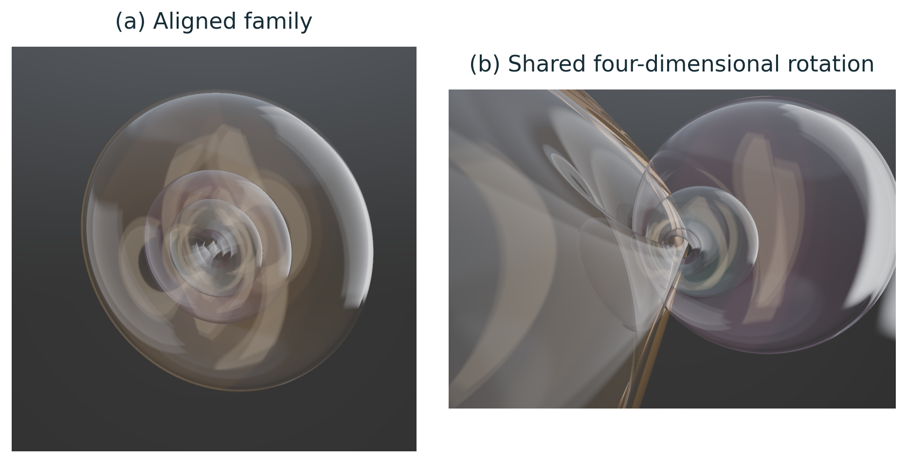

# Hopf Observatory



**[Open the live observatory](https://tommyhax.github.io/hopf-observatory/)** · **[Read the JCGT manuscript (PDF)](papers/jcgt/manuscript.pdf)** · **[Read the technical note (PDF)](papers/technical-note/technical-note.pdf)**

An interactive WebGL 2 ray tracer for stereographic images of rotated Clifford/Hopf tori. The surfaces are never meshed: every pixel's ray is intersected with the exact surface by solving a quartic, with analytic normals and successive reflection and refraction. A screen-filling triangle invokes the shader; there is no mesh, point cloud or ray marching.

The paper in progress is a [draft](papers/jma/DRAFT1.md) ([PDF](papers/jma/draft.pdf)) for the *Journal of Mathematics and the Arts*, on the geometry and the images. The [JCGT review manuscript](papers/jcgt/manuscript.pdf), on rendering and numerical accuracy, is on hold; [REVIEW.md](REVIEW.md) is its review guide. The [technical note](papers/technical-note/technical-note.pdf) has the full derivation, implementation and experiments. All the papers are indexed in [papers/](papers/README.md).

## Run

```sh
npm start
```

Open [the app](http://localhost:8765/) or [the illustrated technical note](http://localhost:8765/technical-note.html). The application source is in `web/` and has no runtime JavaScript dependencies or compilation step. HTTP is required for JavaScript modules. Google Fonts is optional; system-font fallbacks are supplied.

The [technical note](papers/technical-note/technical-note.md) derives the geometry, circular lift of a ray into S³, quartic intersections, normals and Euclidean optics, with experiments and prior work. Its [PDF](papers/technical-note/technical-note.pdf) and [editable LaTeX](papers/technical-note/main.tex) accompany the [build instructions](papers/technical-note/README.md).

## Controls

- Drag to orbit; scroll or pinch to zoom. Keyboard arrows orbit, +/− zoom, and Space toggles animation.
- Checkboxes enable up to three tori. Select a torus to edit its parameter, volume, shell width and material. Initially only the 45° torus is visible, with lilac glass and a 0.01° shell; the other tori have seafoam and soft amber tints.
- **Solid** fills the positive-field side of one boundary. **Shell** fills the angular band between two neighboring tori. Width ranges from 0.01° to 30°, constrained by parameter endpoints. **Apply shell width to all three** copies a common feasible width, including hidden tori.
- **Material** offers tinted glass, clear crystal, chrome and ceramic. **Apply material to all three** copies optical settings while preserving geometry. Materials follow the torus through the projection pole.
- **Rotation** groups all six SO(4) plane angles and automatic rotation. Starting aligned, XW = 90°−t puts a boundary through the pole.
- **Environment** provides six procedural backgrounds and local equirectangular panorama loading, rotation and exposure.
- **Rendering** selects quality, normal/depth inspection and image export. High quality permits 24 main-path interfaces, Adaptive 16 and Fast 8.

[Materials and environments](docs/THREE_TORI.md) explains overlap priority, thin-shell offsets and optical limits.

## Numerical method

For `P = R diag(1,1,0,0) Rᵀ`, `c = cos²t` and `V = (2p, |p|²−1)`, the torus is `Vᵀ(P − cI)V = 0`. Inverse stereographic projection lifts a straight ray to a circle on S³, and substituting the ray gives a polynomial of degree at most four. The degree is intrinsic: the projected tori are Dupin cyclides, which are quartic surfaces.

The ray is recentered at its closest point to the origin. Each half-line uses a near coordinate `x = λ/L` and a reciprocal coordinate `x = L/λ`, both on [0,1], with `L = max(1, |C|)`, so surfaces through infinity need no far clipping sphere. Bernstein derivative roots partition each chart into monotone intervals; bisection and bracket interpolation find crossings, and stationary candidates keep tangencies. Guarded Newton steps against the homogeneous form polish each root, and a scaled residual test accepts it.

Solid material is `QᵀPQ > c`; a shell is `cos²(t+Δt/2) < QᵀPQ < cos²(t−Δt/2)`. Every tracing step takes the nearest boundary across enabled tori, with reflection, Snell refraction and total internal reflection in projected Euclidean 3D.

## Validation

```sh
npm ci
npm run format:check
npm test
npm run build:site
npm run test:gpu   # macOS, Xcode command-line tools and graphics-driver access
python3 scripts/verify-release.py   # offline re-verification of recorded evidence
```

Against an independent exact-rational reference ([research/README.md](research/README.md)), the float32 renderer matches all 1,470 intersections of the 867-ray designed corpus and all 1,800 random, pole and shell queries of the seeded [stress corpus](research/STRESS.md). It fails 109 of 600 deliberately grazing queries natively (123 in WebGL), as do two Yuksel–Peters baselines. Transport checks pass 36 refraction paths with 392 events, and 0.01° shells keep every crossing. See [GPU validation](docs/GPU_VALIDATION.md).

Later diagnostics trace and remove the grazing failures:

| Study | Finding |
| --- | --- |
| [Grazing stages](research/diagnostics/grazing/README.md) | Exact roots of the captured float32 coefficients already fail on all 109: the error is in construction, not solving. |
| [Binary64 replay](research/diagnostics/double-precision/README.md) | Building the coefficients in binary64 recovers all 584 grazing intersections on the CPU. |
| [Paired precision in WebGL](research/diagnostics/browser-precision/README.md) | Float-float construction removes all 123 browser failures, at 4.4–7.5× GPU time. |
| [Closed form on the GPU](research/diagnostics/guarded-direct/README.md) | Ferrari/Cardano on that construction passes every query and the optical suite, at 3.0–5.7× GPU time. |
| [Closed form on the CPU](research/diagnostics/native-algebraic/README.md) | In binary64 the closed form passes every query and is 12× faster than bisection. |
| [Algorithm 1010](research/diagnostics/algorithm1010/README.md) | A float32 closed-form factorization is faster natively but slower in the browser shell scenes. |

The application keeps float32 Bernstein as its default. The paired-precision and closed-form renderers can be previewed in the live app with `node research/diagnostics/browser-precision/serve.mjs` and `node research/diagnostics/guarded-direct/serve.mjs`.

## GitHub Pages and automation

`npm run build:site` assembles `_site/` with the app, illustrated HTML note, figures, detailed PDF and canonical `paper.pdf`. All site links work below a repository subpath such as `/hopf-observatory/`.

The **Tests** workflow runs on pushes and pull requests. It checks formatting, CPU tests, independent-reference reproducibility, the offline evidence gate, site assembly and Chromium browser tests. Browser CI uses SwiftShader software WebGL with a quarter device-pixel ratio to limit CPU rendering cost while keeping the desktop layout. The render check reads an actual shader pixel; numerical checks still cover all 867 rays. The suite has a three-minute limit. Recorded Apple GPU measurements are a separate hardware result. To run the browser suite locally, install Chromium with `npx playwright install chromium`, build the site, then run `npm run test:browser`.

**Deploy GitHub Pages** is manually triggered and restricted to the default branch. It runs the checks before building and deploying. The repository's Pages source must be set to **GitHub Actions** for deployment. No deployment occurs merely by running local build or test commands.

## Maintenance and licence

[Research instructions](research/README.md) cover pinned scientific dependencies, numerical experiments, timing, figure generation and formatting. Regenerate HTML with `./scripts/build-note.sh` and the technical-note LaTeX with `python3 scripts/build-latex.py`. Rebuild the canonical JCGT manuscript with `python3 scripts/build-paper.py --pdf` ([instructions](papers/jcgt/README.md)) and the JMA draft PDF with `./scripts/build-jma.sh`. Prepare the versioned supplementary archive from committed source with `python3 scripts/package-release.py --version v0.1.0-review.4 --source HEAD`; see [release and provenance instructions](docs/RELEASE.md).

The implementation is MIT licensed, copyright 2026 Tom Crosby. The numerical baselines retain their [upstream notices](research/THIRD_PARTY.md); the experimental Algorithm 1010 port retains its [BSD licence](research/diagnostics/algorithm1010/LICENSE), and the closed-form solvers adapted from Boost.Math retain the [Boost Software License](research/diagnostics/guarded-direct/LICENSE_1_0.txt).

## Limits

The default renderer uses float32: near-tangent rays can gain, lose or misplace a pair of intersections, and rounding the geometry near the pole can remove a remote intersection before any computation. Origin offsets can skip features below their scale. The shell is an angular band in S³, not a constant Euclidean thickness. All measurements use one Apple M3 Pro.

Transport uses a bounded main path and a limited reflected branch. Rough reflections, conductor Fresnel colors and absorption in unbounded material are approximations. Remaining energy resolves to the environment at the interaction limit. There are no caustics, spectral dispersion or full global illumination.
