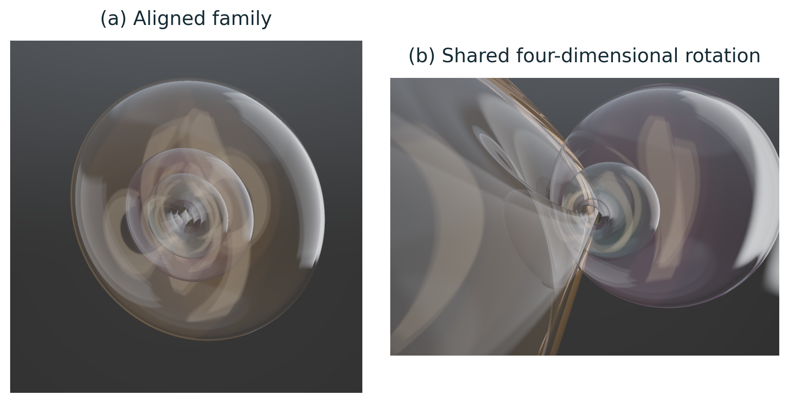

## Abstract

We ray trace stereographic images of rotated Hopf tori exactly and interactively in a web browser, including glass solids, thin angular shells and surfaces that pass through the projection pole. The surfaces are never meshed. The tori are level sets of a rank-two quadratic form on the three-sphere, and inverse stereographic projection lifts a camera ray to a circle, so every intersection is a root of a quartic in the original ray parameter. Near and reciprocal ray charts keep that quartic on bounded domains when the projected surface is unbounded. Against exact rational roots, the float32 renderer matches every intersection in 867 designed and 1,800 seeded queries, but fails 109 of 600 deliberately grazing queries. We show that these failures arise when the polynomial coefficients are constructed, not when they are solved: exact solving of the captured coefficients reproduces all of them, and building the coefficients in higher precision removes all of them, on the CPU and in WebGL with float-float arithmetic. A closed-form Ferrari solver on the GPU is then also correct, and is faster than float-float iterative isolation in three of four scenes, but remains 3–6 times slower than the float32 renderer. On the CPU in binary64 the same closed form is 12 times faster than bisection.

## 1. Motivation and scope

The starting aim was to ray trace three-dimensional stereographic images of the product of two circles,
$$
(\cos u,\sin u,\cos v,\sin v).
$$
The angles $u$ and $v$ independently traverse the two circles. This surface has constant distance $\sqrt{2}$ from the origin in $\mathbb R^4$; dividing its coordinates by $\sqrt{2}$ places it in the unit three-sphere $S^3$, where it is the standard Clifford torus. We wanted to render the images obtained by rotating this torus in four dimensions before projecting it into three.

In its initial orientation, the stereographic image is an ordinary ring torus. Under rotation it deforms and can appear to turn inside out: the torus passes through the projection pole, making its three-dimensional image unbounded while the surface in $S^3$ remains smooth and compact. This geometry is established [@banchoff1990; @mccuan1998]. Visualizations of it commonly approximate the surfaces with polygon meshes, tubes or sampled distance fields. For ray tracing, the challenge is to find the nearest exact surface intersection as these images change, including intersections arbitrarily far along a ray near the pole-crossing configuration. Reflection and refraction require repeating that calculation at successive boundaries.

The useful geometric step is to place the original torus in a family: give the two circles radii $\cos t$ and $\sin t$, with $0<t<\pi/2$. Every member still lies in $S^3$, and $t$ selects a torus by a simple scalar membership condition. Inverse stereographic projection carries a straight camera ray to a circular arc on $S^3$. Every point of that arc is already on the sphere; the intersections we seek occur where it meets the selected torus. Section 2 develops this condition into a polynomial of degree at most four in the original ray parameter. Finding its forward roots supplies the intersections without constructing a surface mesh.

Hopf Observatory implements this in WebGL 2, with six-plane $SO(4)$ rotations, up to three torus regions, angular shells down to $0.01^\circ$, and Euclidean reflection and refraction in the projected space (Figure 1). A fullscreen triangle dispatches one ray per pixel. The paper contributes:

- **Exact interactive rendering of the family.** A compact derivation of the ray quartic and analytic normals from a rank-two projector, and near/reciprocal ray charts that handle surfaces through infinity without a far clipping sphere (Sections 2 and 3).
- **A measured account of where float32 fails.** An independent exact-rational reference and stage-by-stage captures show that the remaining grazing failures are created during coefficient construction, before any root is sought (Sections 4.1–4.3).
- **Remedies and their cost.** Higher-precision construction removes every measured failure on the CPU and the GPU. We compare iterative and closed-form solvers on that construction, on both processors (Sections 4.4 and 4.5).

Ray tracing algebraic surfaces [@hanrahan1983], GPU Bernstein methods [@seland2007], derivative-partitioned root finding [@yuksel2022; @peters2023], refinement against the original implicit field [@szente2026] and float-float arithmetic [@dekker1971] all predate this work. We do not claim a new general root-finding algorithm.

{#fig:teaser width=100%}

## 2. Geometry and the projection pole

Write $q=(q_1,q_2,q_3,q_4)^T$ for a point of the unit sphere $S^3\subset\mathbb R^4$. The family described above is parameterized by
$$
X(t,u,v)=(\cos t\cos u,\cos t\sin u,\sin t\cos v,\sin t\sin v)^T,
\quad 0<t<\pi/2.
$$
For fixed $t$, the angles $u,v$ modulo $2\pi$ locate a point on the torus $T_t=S^1(\cos t)\times S^1(\sin t)$. The parameter $t$ selects its two radii, and $|X(t,u,v)|^2=\cos^2t+\sin^2t=1$. At $t=\pi/4$ this is the normalized product of circles introduced in Section 1.

As $t$ varies over $(0,\pi/2)$, these disjoint tori cover $S^3$ except for the two circles where one coordinate pair vanishes. At $t=0$ the $v$-circle collapses, and at $t=\pi/2$ the $u$-circle collapses. Including those endpoint images gives all of $S^3$.

For a point already on $S^3$, membership in $T_t$ is exactly the condition
$$
q_1^2+q_2^2=\cos^2t.
$$
For a rotated torus $RT_t$, with $R\in SO(4)$, apply the same test to $R^Tq$. Setting $P=R\,\mathrm{diag}(1,1,0,0)R^T$ and $c=\cos^2t$ writes this condition as $q^TPq=c$. Here $P$ projects onto the rotated plane of the first circle. Rotations within either circle's plane only shift $u$ or $v$, so the six rotation controls are redundant: $SO(2)\times SO(2)$ stabilizes the original projector, leaving four continuous rotational degrees of freedom at fixed $t$.

Use the north pole $N=(0,0,0,1)^T$ and stereographic projection $p=q_{1:3}/(1-q_4)$. Its inverse is
$$
Q(p)=\frac{V(p)}{1+|p|^2},\qquad V(p)=(2p,|p|^2-1)^T.
$$
Since $|Q(p)|=1$, a camera ray $p(s)=o+sd$, $s\geq0$, lifts to a curve entirely on $S^3$. The lift of the complete line, together with its limiting point $N$, is a circle; the forward ray traces an arc approaching $N$ as $s\to+\infty$. Its intersections with the rotated torus satisfy
$$
Q(o+sd)^TPQ(o+sd)-c=0.
$$
This is the scalar equation to solve along the lifted ray. Clearing the strictly positive denominator $(1+|p|^2)^2$, and using $V^TV=(1+|p|^2)^2$, gives the implicit surface equation
$$
f_c(p)=V^T(P-cI)V=0.
$$
Substituting $p=o+sd$ gives a polynomial of degree at most four, because $V(o+sd)$ is quadratic in $s$. Its positive real roots give forward intersections. The supplementary technical note derives the circular lift and the full polynomial coefficients.

The degree is intrinsic. A line lifts to a great circle only if it passes through the origin, the image of $-N$; along a great circle the condition is quadratic in the tangent of the arc angle. Every other line lifts to a smaller circle, on which $q^TPq$ mixes constant, first and second harmonics of the angle, giving a quartic. Equivalently, projecting the lifted circle onto the plane of $P$ gives an ellipse, and the torus is the circle of radius $\cos t$ about the origin of that plane: the hits are the at most four points where they cross. The projected tori are Dupin cyclides, which are quartic surfaces [@banchoff1990]. No other projection keeps their round, conformal appearance while straightening the lifted rays: by Liouville's theorem the conformal maps $S^3\to\mathbb R^3$ are stereographic projections followed by Möbius transformations, and by Beltrami's theorem the maps sending great circles to lines are central projections up to projective transformation, none of which is conformal.

The exact gradient is
$$
\nabla f_c=4\left[(PV)_{1:3}+p\big((PV)_4-c(1+|p|^2)\big)\right].
$$
Its normalized direction supplies smooth surface normals. The pole lies on the rotated torus when $N^TPN=c$, equivalently $P_{44}=c$. The ray polynomial's leading coefficient is $(P_{44}-c)|d|^4$, so this pole condition removes the quartic term; the remaining polynomial still describes finite intersections. Figure 2 shows the projected surface on both sides of the pole condition.

{#fig:pole width=100%}

## 3. Intersection and optical implementation

### 3.1 Bounded ray charts

For unit $d$, write $k=o\cdot d$, $C=o-kd$, $\lambda=s+k$ and $L=\max(1,|C|)$. Each signed half-line uses a near coordinate $x=|\lambda|/L\in[0,1]$ and a reciprocal coordinate $x=L/|\lambda|\in(0,1]$. Let $e=\sigma d$, with $\sigma\in\{-1,1\}$, and define
$$
\begin{aligned}
a&=(2C/L^2,(|C|^2-1)/L^2)^T,\\
b&=(2e/L,2C\cdot e/L)^T,\qquad h=(0,0,0,e\cdot e)^T.
\end{aligned}
$$
The near numerator is $W(x)=a+bx+hx^2=V(C+Lxe)/L^2$. In the reciprocal chart, multiplication by $x^2$ reverses the coefficients: $W(x)=h+bx+ax^2=x^2V(C+Le/x)/L^2$. Both yield bounded polynomial domains for $g=W^T(P-cI)W$. The reciprocal endpoint $x=0$ represents infinity and is excluded from finite hits.

For either chart, write $W=a'+b'x+c'x^2$, set $w_0=a'$, $w_1=a'+b'/2$, $w_2=a'+b'+c'$, and define $B(a,b)=a^T(P-cI)b$. The quartic Bernstein coefficients are constructed directly:
$$
\begin{aligned}
b_0&=B(w_0,w_0), & b_1&=B(w_0,w_1),\\
b_2&=\bigl(B(w_0,w_2)+2B(w_1,w_1)\bigr)/3,\\
b_3&=B(w_1,w_2), & b_4&=B(w_2,w_2).
\end{aligned}
$$
The scale $L^{-2}$ limits coefficient growth before the quadratic products are formed, and degree loss at the pole needs no division by a small leading coefficient. In the reciprocal chart, relative perturbations of $x$ and $|\lambda|=L/x$ have approximately equal magnitude, so distant hits keep relative resolution.

### 3.2 Isolation, refinement and acceptance

Derivative roots partition the quartic into monotone intervals. The shader solves the derivative hierarchy from linear through quartic using Bernstein coefficient differences and de Casteljau evaluation. A strictly one-signed coefficient set rejects a chart immediately. Sign-changing intervals receive at most 25 bisection steps followed by interpolation within the final bracket. Near-zero stationary values supply tangent-contact candidates when neither adjacent interval already contains a sign change; after normalizing each polynomial by its largest coefficient, the stationary threshold is $2.5\times10^{-7}E(x)+2\times10^{-9}$, where $E$ evaluates the polynomial with absolute coefficients.

Up to four Newton steps then polish each candidate against the homogeneous form, with $g'=2(b'+2xc')^T(P-cI)W$. A step must stay in $[0,1]$, move by at most $0.05\max(x,10^{-6})$ and strictly reduce the computed $|g|$. With $M=|W|^T|P-cI||W|$ taken componentwise, a candidate is accepted when
$$
\rho=\frac{|g|}{M+|g'|\,\eta}<2\times10^{-6},\qquad
\eta=\begin{cases}1&\text{near chart},\\x&\text{reciprocal chart}.\end{cases}
$$
The factor $x$ converts the derivative term to relative distance in the reciprocal chart, so a fixed tolerance does not admit increasingly inaccurate distant roots. Listing 1 summarizes the nearest-boundary query; the helpers are `chartVectors`, `chartPoly`, `quarticRoots`, `refineChart` and `chartIntersection` in `web/shader.js`.

```{#lst:intersection .text caption="Nearest finite intersection with one boundary (Section 3.2)."}
nearestBoundary(o, d, level, minS):
    k = dot(o, d); C = o - k*d; L = max(1, length(C))
    charts = [(+1, near), (+1, reciprocal)]
    if k < 0:
        prepend [(-1, reciprocal), (-1, near)] to charts
    for (sign, kind) in charts:
        W = chartVectors(C, sign*d, L, kind)
        b = bernsteinCoefficients(W, level)
        if all b > 0 or all b < 0: continue
        best = infinity
        for x in isolate(b):
            x = refineHomogeneous(W, level, x)
            if kind == reciprocal and x <= 0: continue
            distance = L*x if kind == near else L/x
            s = sign*distance - k
            if finite(s) and s > minS
               and residual(W, level, x, kind) < 2e-6:
                best = min(best, s)
        if best < infinity: return best
    return none
```

### 3.3 Materials and transport

A solid fills $Q^TPQ>c$. A shell is a band between two parameter levels,
$$
\cos^2(t+\Delta t/2)<Q^TPQ<\cos^2(t-\Delta t/2),
$$
whose boundaries are solved independently and have opposite outward normals. Shell width is angular in $S^3$, not a constant Euclidean thickness. Up to three regions share $P$; where their bands overlap, the narrowest level interval has priority.

Each tracing step chooses the nearest enabled boundary, identifies the incident and transmitted media, and applies Snell refraction or total internal reflection in Euclidean $\mathbb R^3$. Let $\gamma$ be the smallest angular separation between enabled boundaries, in radians. The bias scale $\beta=\operatorname{clamp}(0.05\gamma,10^{-6},4\times10^{-4})$ sets the positive-distance cutoff $\beta\max(1,|o|)/2$ and the post-hit offset $\beta\max(1,|p|)$, which retains the $0.01^\circ$ walls tested below. The main path allows up to 24 boundary interactions and the first reflected branch fewer. Absorption, Fresnel weighting and environment lighting are approximations; there are no caustics or global illumination.

## 4. Evaluation

All hardware measurements use one Apple M3 Pro. Native tests run the production GLSL through OpenGL 4.1 on Metal; browser tests use WebGL 2 through ANGLE Metal in Chrome. Results are labelled by backend because rounding differs between them.

The reference expands the original ray polynomial in exact rational arithmetic and isolates its positive roots with SymPy's continued-fraction method [@meurer2017], to brackets no wider than $10^{-30}$. It shares no code with the renderer. It is computed twice: from the exact binary values of the float32 inputs supplied to the GPU, and from the intended geometry at 80 significant digits. The first measures the solver; comparing the two measures input rounding.

Every method under test enumerates all distinct positive roots of the unchanged original ray, without origin advance, rendering bias or far clipping. Outputs are matched one-to-one to reference roots with maximum cardinality, using relative distance error $|s-s_{\mathrm{ref}}|/\max(1,|s_{\mathrm{ref}}|)\le\tau$. A query fails if any reference root or any output is unmatched. Unless stated otherwise, $\tau=10^{-4}$.

### 4.1 Accuracy of the float32 renderer

The original corpus has 867 designed rays and 1,470 roots: pole sweeps with offsets down to adjacent float32 values, silhouettes, chart junctions, contained lines and six-plane rotations, with intersections up to about $2.4\times10^9$ units away. Production Bernstein and an adaptation of Peters's GLSL implementation [@peters2023] of Yuksel's method [@yuksel2022], in centered and chart coordinates, all match every root before and after refinement. A float32 port of the classical Ferrari/Cardano formulas fails 378 rays after refinement.

A seeded stress corpus of 2,400 boundary queries was then fixed before evaluation:

| Family | Queries | Represented roots | Input-rounding changes | Native failures |
|---|---:|---:|---:|---:|
| Random | 600 | 861 | 0 | 0 |
| Pole | 600 | 501 | 253 | 0 |
| Grazing | 600 | 584 | 304 | 109 |
| Shell | 600 | 1,368 | 13 | 0 |

Every non-grazing query passes, and all 100 three-shell groups keep their boundary order. The 600 grazing queries comprise 200 exact rational double contacts and 400 nearby rays; on these, all three modern solvers fail the same 109 query IDs (40 missing intersections, 34 extra intersections and 35 misplaced ones). The browser fails 123 of the same family. Separately, rounding the intended inputs to float32 changes 570 root sets: near the pole, a remote intersection of the intended geometry can be absent from the uploaded polynomial, and no solver can restore it. The grazing corpus is deliberately adversarial and does not estimate how often such errors appear in ordinary views.

### 4.2 Optics, images and cost

Instrumented transport passes 36 refraction paths with 392 interface events, 31 focused thin-shell sequences and 1,161 solid, shell and multi-torus probes. Each $0.01^\circ$ single shell retains its eight crossings along the axis, and three shells retain all 24. Twelve further paths from the seeded shell groups are checked boundary by boundary against the exact reference, with independent normals, medium probes and Snell residuals: all 167 boundary events pass for each solver, with hit-distance error below $3.97\times10^{-6}$. In 30 image comparisons against Bernstein, the largest frame-mean RGB difference is $2.82\times10^{-6}$; a single pixel differs by 0.341.

Native frame times at 1280×720 with a 24-interaction budget (medians of 30 frames in three alternating blocks):

| Scene | Bernstein | Yuksel, centered | Yuksel, charts |
|---|---:|---:|---:|
| One solid | 3.13 ms | 2.86 ms | 2.88 ms |
| One 0.01° shell | 5.63 ms | 6.38 ms | 5.55 ms |
| Three 0.01° shells | 19.78 ms | 33.02 ms | 22.27 ms |
| Three shells, XW = 45° | 38.45 ms | 67.69 ms | 45.74 ms |

Bernstein is slightly slower for a single solid and level with the chart variant for one shell, but fastest for the three-shell scenes the application is built around, so it remains the default.

### 4.3 Where the grazing failures arise

To locate the 109 native failures, separate GPU probes captured every intermediate quantity for all 600 grazing queries, and exact arithmetic solved each captured stage:

| Stage solved or observed | Failed / 600 | Of final 109 |
|---|---:|---:|
| Exact ray from captured center $C$ and offset $k$ | 39 | 34 |
| Captured chart vectors $W$, exact $P-cI$ | 103 | 88 |
| Captured $W$, float32 $P-cI$ | 106 | 90 |
| Exact roots of captured coefficients | 109 | 109 |
| GPU isolated, refined and accepted roots | 109 | 109 |

Exact roots of the captured coefficients already fail on all 109 queries, with the same 40 missing, 34 extra and 35 misplaced intersections. The damage is done before any root is sought; a better solver cannot repair it. Earlier stages are not nested, and errors partly cancel, so the rows are not an additive budget. Removing Bernstein's proximity merging changes no output, and the residual filter rejects no grazing candidate (Figure 3).

{#fig:grazing width=100%}

### 4.4 Higher-precision construction

A CPU replay tests the remedy directly. It uses the JavaScript Bernstein solver in binary64 on the same uploaded float32 geometry, fed either with the captured float32 coefficients or with coefficients rebuilt in binary64:

| Construction and solving | Failed / 600 | Matched / 584 |
|---|---:|---:|
| Native float32 GPU (production) | 109 | 436 |
| Float32 coefficients, binary64 solving | 109 | 434 |
| Binary64 construction and solving | **0** | **584** |

Solving float32 coefficients more accurately changes nothing. Building them in binary64 recovers every intersection, with largest relative error $4.9\times10^{-12}$, and the result still passes every query at $\tau=10^{-10}$.

WebGL has no double type, and Apple GPUs have no binary64 hardware. We therefore represent sensitive values as unevaluated sums of two float32 values [@dekker1971], with error-free sums and split products. An integer XOR with a uniform that is always zero forces each intermediate rounding, so the compiler cannot reassociate away the recovered error terms. The paired arithmetic covers ray recentering, chart vectors, $P-cI$, Bernstein coefficient construction, refinement and residuals; the existing float32 isolator runs on the rounded coefficients, with up to 48 bisection steps. In WebGL this variant matches all 4,784 intersections on both corpora, against 123 production failures, with largest relative error $2.2\times10^{-7}$. It passes the complete optical suite. Its cost appears with the closed-form solver's in Section 4.5.

### 4.5 Closed-form solving

With accurate coefficients, a direct solver becomes viable. We evaluated Ferrari's quartic method with Cardano's cubic, adapted from Boost.Math [@thompson2021] with all root polishing removed, on the same paired construction. Its float32 path guards cancellation, small discriminants and degree loss; when a guard fires, the whole closed form is re-evaluated in paired arithmetic from the retained coefficients. There is no root search, polishing or residual rejection. In WebGL it matches every intersection of all 3,267 queries and 54 polynomial fixtures, and passes the complete optical suite. Images agree with production to within two RGB8 code values in every shell scene.

The table gives GPU elapsed time at 1280×720 with 24 interactions. Each ratio is relative to the float32 renderer measured in the same run, with variants alternating across three blocks of ten frames.

| Scene | Float32 Bernstein | Paired + Bernstein | Paired + closed form |
|---|---:|---:|---:|
| One solid | 4.7–5.0 ms | 4.48× | 2.99× |
| One 0.01° shell | 8.9–9.4 ms | 4.35× | 4.83× |
| Three 0.01° shells | 28.2–32.2 ms | 7.54× | 5.74× |
| Three shells near the pole | 79.4–92.4 ms | 7.05× | 5.37× |

In binary64 on the CPU, with no escalation needed, the same closed form passes every query at $\tau=10^{-8}$ and takes 0.28 µs per query against 3.45 µs for a bisection solver under identical construction and compiler settings: 12 times faster. A float32 implementation of Algorithm 1010 [@orellana2020; @demichele2024], a modern closed-form factorization, was likewise faster natively but took 37–55% more browser GPU time than Bernstein on three-shell scenes.

The direction of the comparison reverses because the GPU penalizes what the closed form needs. Its cube roots, square roots, inverse cosine and trigonometric evaluation run on lower-throughput units, and in paired arithmetic they become software expansions. Its many branches diverge within SIMD groups. Its long formula chain also amplifies rounding: the float32 guard escalates 84% of the corpus queries, so most of them pay for both evaluations. Bernstein, by contrast, rejects a chart with no possible root by a single sign test and stops at the first chart with a hit. We have not timed these factors separately.

## 5. Discussion and limitations

The evaluation separates three kinds of error: the float32 geometry can differ from the intended one; the constructed polynomial can differ from the one the float32 geometry defines; and its roots can be found inaccurately. Only the third concerns the root solver, and on this family it is not the limiting one. Comparisons of ray–surface solvers should therefore include coefficient construction, and record raw candidates alongside accepted hits.

Higher-precision construction fixes the measured failures but costs four to seven times the frame time, too much for the default interactive renderer. Two cheaper directions are open. Paired arithmetic could be applied only to rays whose float32 coefficients are near a decision. Alternatively, because all tori share $P$, every boundary along a ray is a level set of the single function $q^TPq$; its critical points do not depend on the level. Locating them once per ray would replace per-level construction for shells and multiple tori, and would turn tangency decisions into comparisons of each level with the function's extreme values.

The limits are explicit. All measurements use one GPU, one driver stack and float32 inputs. Paired float32 values have float32 exponent range and do not supply all binary64 significand bits. The corpora were reused during development of the higher-precision variants, so their success rates are not independent estimates. Guards and thresholds are heuristics, not certified bounds. Finite origin offsets and interaction budgets limit the thinnest resolvable features and the longest optical paths.

## 6. Conclusion

Stereographic images of rotated Hopf tori can be ray traced exactly, interactively and with refraction, including the unbounded surfaces that occur at the projection pole. The tori's level-set structure on $S^3$ makes each intersection a quartic in the ray parameter. A float32 implementation matches an exact reference except on deliberately grazing rays, and those failures arise in constructing the quartic, not in solving it. Constructing it in higher precision removes them, and makes a direct closed-form GPU solver correct, but in this setting closed-form solving does not beat iterative isolation on speed.

The companion package's `REVIEW.md` is the entry point. `papers/technical-note/technical-note.md` contains the complete derivation and implementation discussion; `research/README.md`, `research/STRESS.md` and `research/diagnostics/` give seeds, raw results, exact brackets and reproduction commands. The buildless WebGL application runs with `npm start`.

## Assistance and responsibility

Tom Crosby conceived the geometric approach, directed the project and is responsible for the conclusions. OpenAI Codex assisted with derivation, implementation, experiments, literature checking and drafting. Anthropic Claude assisted with revising this manuscript. Both are AI tools, not authors. The independent references and tests verify results within their stated scope. Figures are deterministic outputs of the supplied code.

## Index of supplemental materials

- `web/`: WebGL 2 application, with intersections and optics in `shader.js`.
- `papers/technical-note/technical-note.pdf`: extended derivations, implementation and experiments.
- `research/README.md`, `research/STRESS.md`: corpora, protocols, exact references, transport captures and timings.
- `research/diagnostics/grazing/`: stage captures and exact replays of the grazing failures.
- `research/diagnostics/double-precision/`: binary64 CPU replay of the grazing queries.
- `research/diagnostics/browser-precision/`: paired float32 construction in WebGL.
- `research/diagnostics/guarded-direct/`: the closed-form GPU solver.
- `research/diagnostics/native-algebraic/`: the binary64 closed-form CPU study.
- `research/diagnostics/algorithm1010/`: Algorithm 1010 evaluation, with BSD attribution.
- `REVIEW.md`, `research/THIRD_PARTY.md` and `LICENSE`: review instructions and software provenance.

## References

The bibliography is maintained in `papers/jcgt/references.bib` and typeset with the official JCGT BibTeX style.
