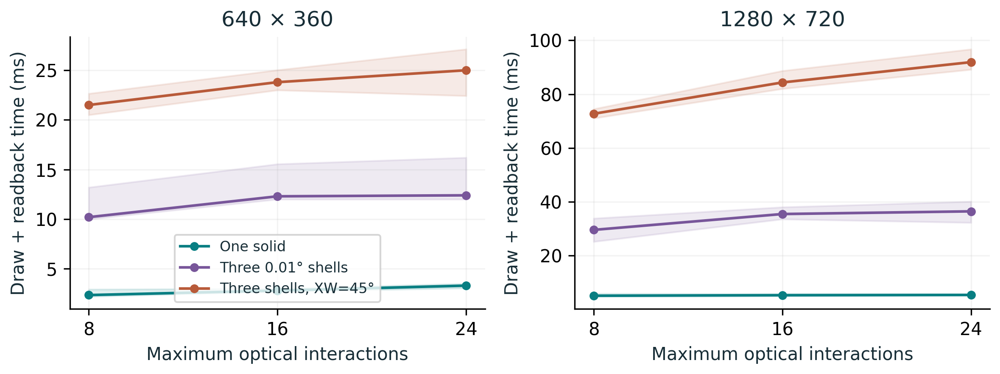

## Abstract

This note describes an interactive GPU ray tracer for stereographic images of rotated Hopf tori, and derives everything it computes. The tori are level sets of a rank-two quadratic form on the three-sphere. A straight camera ray lifts to a circle on that sphere, so each intersection is a root of a quartic in the ray parameter, with analytic normals from the same form. Closest-point recentering and near/reciprocal ray coordinates keep the quartic on bounded intervals even when the projected surface passes through infinity. The renderer supports three simultaneous material regions, including angular shells $0.01^\circ$ thick, with successive Euclidean reflection and refraction. Nothing is meshed.

An independent exact-rational reference evaluates the float32 renderer. It matches all 1,470 intersections of an 867-ray designed corpus, including pole crossings with hits $2.4\times10^9$ units away, and all 1,800 random, pole and shell queries of a seeded stress corpus. It fails 109 of 600 deliberately grazing queries, as do two modern iterative baselines. Section 11 shows that these failures arise when the polynomial coefficients are constructed in float32, not when they are solved. Constructing them in higher precision removes every failure on the CPU and in WebGL. With that construction, a closed-form Ferrari solver is also correct on the GPU and faster than iterative isolation in three of four scenes, but 3–6 times slower than the float32 renderer; in binary64 on the CPU it is 12 times faster than bisection. The short review manuscript is supplied separately as `papers/jcgt/paper.md`.

## The accompanying demonstration

The complete working demo is included in this project. From the `hopf-observatory` directory:

```sh
npm start
```

The app is served at `http://localhost:8765/`. [Open the observatory](index.html) or [the illustrated browser note](technical-note.html). The app needs WebGL 2. Opening `index.html` directly with a `file:` URL is insufficient because the app uses JavaScript modules. The note's rendered equations use native MathML and require no external mathematics service.

<div class="demo-block">
<p><a href="index.html" target="_blank" rel="noopener">Open the local demo in its own tab</a></p>
<iframe src="index.html" title="Hopf Observatory: interactive quartic ray tracer" loading="lazy" allow="fullscreen"></iframe>
</div>

Drag to orbit the 3D camera; scroll or pinch to zoom. The six rotation sliders act in XY, XZ, XW, YZ, YW, and ZW. The app initially shows the $45^\circ$ torus as a tinted shell of width $0.01^\circ$; two further tori can be enabled with checkboxes. **Selected torus** groups its geometry and material controls. **Rotation** contains the six shared angles and automatic rotation. For an otherwise aligned solid, XW rotation crosses the pole at $90^\circ-t$; a shell has two nearby crossings. High quality allows 24 main-path interactions.

The surface is never converted to a polygon mesh or point cloud. A screen-filling triangle only invokes a fragment shader; each fragment independently constructs a ray and solves its intersection equation. Polynomial evaluations during root finding are numerical equation solving, not sampling a collection of surface points or ray marching through space.

{#fig:family width=100%}

### Contributions

This project contributes (i) a self-contained, projector-based derivation of the ray intersections and normals, including why the problem is intrinsically quartic (the surface equation itself is the classical description of a cyclide [16]); (ii) directly constructed Bernstein coefficients in near/reciprocal charts, with closest-point recentering and homogeneous-form polishing; (iii) multi-region solid and shell optics, including $0.01^\circ$ parameter bands; (iv) an evaluation that separates input rounding, coefficient construction and root solving; and (v) higher-precision construction in WebGL, with iterative and closed-form solvers compared on it. Each ingredient has prior work. Visualizations of these tori commonly approximate them with polygon meshes, tubes or ray-marched distance fields, and a general ray tracer such as POV-Ray can render one quartic exactly once its equation is supplied. Here the equation comes from the four-dimensional geometry for every rotation and every member of the family, and one renderer handles solids, angular shells and passage through infinity together, at interactive rates.

## 1. A family of tori and a coordinate on the three-sphere

Write a point $q=(q_1,q_2,q_3,q_4)^T$ of $S^3\subset\mathbb R^4$ as two complex coordinates $z_1=q_1+iq_2$ and $z_2=q_3+iq_4$, with $|z_1|^2+|z_2|^2=1$. For $0<t<\pi/2$ define

$$
X(t,u,v)=(\cos t\cos u,\cos t\sin u,\sin t\cos v,\sin t\sin v)^T.
$$

For each fixed $t$, the image $T_t$ is $S^1(\cos t)\times S^1(\sin t)$. The angles $u,v$ locate a point on this torus; $t$ selects the two circle radii. The identity $|X(t,u,v)|^2=\cos^2t+\sin^2t=1$ places every member in $S^3$. At $t=\pi/4$ this is the standard Clifford torus, obtained by dividing $(\cos u,\sin u,\cos v,\sin v)$ by $\sqrt{2}$. Every point away from the two circles $z_1=0$ and $z_2=0$ has a unique value

$$
\tau(q)=\operatorname{atan2}\!\left(\sqrt{q_3^2+q_4^2},\sqrt{q_1^2+q_2^2}\right).
$$

With $u,v$ taken modulo $2\pi$, $X$ gives coordinates on the complement of those circles: $(0,\pi/2)\times T^2$. Thus the family foliates that complement by disjoint tori. At $t=0$ the $v$-circle collapses, and at $t=\pi/2$ the $u$-circle collapses; including these endpoint images gives all of $S^3$. For $q\in S^3$, membership in $T_t$ is exactly $q_1^2+q_2^2=\cos^2t$. We use $X$ for the parameterization and $q$ for a point on the sphere throughout.

For the Hopf map

$$
H(z_1,z_2)=\bigl(2\operatorname{Re}(z_1\overline{z_2}),\ 2\operatorname{Im}(z_1\overline{z_2}),\ |z_1|^2-|z_2|^2\bigr),
$$

$H(T_t)$ is the latitude with third coordinate $\cos 2t$. These are therefore Hopf tori. An arbitrary rotation in $SO(4)$ transports this description to a correspondingly rotated Hopf fibration; it need not preserve the particular fixed Hopf map written above.

Recovering $t$ on $S^3$ supplies a level-set membership test. To use it for projected ray tracing, the remaining issue is the curve on $S^3$ corresponding to a straight ray in the projected scene.

## 2. Lifting a 3D ray: a circle, not a straight 4D ray

Use the north pole $N=(0,0,0,1)$ and stereographic projection

$$
\sigma(q)=\frac{q_{1:3}}{1-q_4}.
$$

For $p=(x,y,z)$, let $D=1+|p|^2$ and

$$
V(p)=(2x,2y,2z,|p|^2-1),\qquad Q(p)=\frac{V(p)}D.
$$

Direct substitution gives $|Q(p)|=1$ and $\sigma(Q(p))=p$. Therefore every point on the lifted ray $Q(o+s d)$ is already on $S^3$. Intersecting a straight 4D ray with the hypersphere and then testing one or two sphere hits would not solve the projected ray-tracing problem.

The lift of the complete 3D line, together with $N$, is a circle. To see this, choose independent vectors $e_1,e_2$ perpendicular to its direction $d$. The line obeys $e_i\cdot p=e_i\cdot o$, so its lift obeys

$$
e_i\cdot q_{1:3}=(e_i\cdot o)(1-q_4),\qquad i=1,2.
$$

These are two affine hyperplanes in $\mathbb R^4$, both containing $N$. Their common two-plane cuts the unit sphere in a circle. A forward camera ray lifts to an arc ending at $N$ as $s\to+\infty$.

The desired intersections are precisely the points along this arc at which the torus coordinate has the chosen value. The rational map $Q$ turns that test into the ray polynomial below.

### Why the intersection is a quartic

The lifted line is a great circle only when its plane passes through the origin of $\mathbb R^4$, that is, when it also contains $-N$. Since $\sigma(-N)=0$, this happens exactly for lines through the origin of the projected space. On a great circle $q=a\cos\varphi+b\sin\varphi$, the membership condition $q^TPq=c$ is a homogeneous quadratic in $(\cos\varphi,\sin\varphi)$, so it is quadratic in $\tan\varphi$. Every other line lifts to a smaller circle $q=m+r(a\cos\varphi+b\sin\varphi)$ with $m\neq0$. Then $q^TPq$ contains constant, first and second harmonics of $\varphi$, and the condition becomes a quartic in $\tan(\varphi/2)$.

There is a planar picture of the same fact. $P$ projects onto a two-plane, and $q^TPq=|Pq|^2$. Projecting the lifted circle into that plane gives an ellipse, possibly degenerate, while the torus becomes the circle of radius $\cos t$ about the origin. The intersections are the points where the ellipse crosses that circle, of which there are at most four unless the two curves coincide. The lifted circle passes through $N$, so the ellipse passes through $PN$, and $|PN|^2=P_{44}$; coincidence therefore requires the pole condition $P_{44}=c$ of Section 6. Under that condition $PN$ is a common point of the two curves for every ray. Its preimage $N$ is excluded, but if the ellipse degenerates to a segment, any other preimage of $PN$ is a legitimate finite hit. A line whose ellipse is the circle lies entirely on the surface. At $t=45^\circ$ after a $45^\circ$ XW rotation, for example, the line through the origin in direction $(0,1,1)$ is contained in the surface. The ellipse depends only on the ray and $P$, so every torus in a family sharing $P$ is a different circle in the same picture.

The projected tori are Dupin cyclides, which are quartic surfaces [1]; a line can meet one four times, so no method avoids a degree-four problem for these images. A different projection could straighten the lifted rays, but it would lose what makes the images worth drawing. By Liouville's theorem the conformal maps from $S^3$ to $\mathbb R^3$ are stereographic projections followed by Möbius transformations. By Beltrami's theorem the maps that send great circles to straight lines are central projections up to projective transformation, and none of these is conformal. Gnomonic projection, for example, turns the tori into quadrics with quadratic intersections, but distorts their shape.

{#fig:lift width=100%}

## 3. Rotation and the implicit quartic

Let $R\in SO(4)$ and

$$
P_0=\operatorname{diag}(1,1,0,0),\qquad P=RP_0R^T,\qquad c=\cos^2t.
$$

The rotated torus is parameterized by $RX(t,u,v)$. Applying the unrotated membership test to $R^Tq$ characterizes it by $q^TPq=c$ on $S^3$. The matrix $P$ is a symmetric rank-two orthogonal projector: $P^T=P$, $P^2=P$, and $\operatorname{tr}P=2$.

The implementation constructs $R$ by successively left-multiplying rotations in the six coordinate planes. Changing their order generally changes the result. Every supported rotation still uses the same projector and intersection formulas.

The six rotation parameters do not give six independent geometric degrees of freedom for the torus. For $H=\operatorname{diag}(H_1,H_2)$ with $H_1,H_2\in SO(2)$,

$$
HP_0H^T=P_0,\qquad (RH)P_0(RH)^T=RP_0R^T.
$$

These two rotations shift the circle phases $u,v$ without changing the surface. The full stabilizer of $P_0$ within $SO(4)$ is $S(O(2)\times O(2))$, the block-diagonal orthogonal matrices with total determinant one; its identity component is $SO(2)\times SO(2)$. Thus the projectors form the unoriented Grassmannian of two-planes in $\mathbb R^4$,

$$
\operatorname{Gr}_2(\mathbb R^4)\cong SO(4)/S(O(2)\times O(2)),\qquad
\dim\operatorname{Gr}_2(\mathbb R^4)=6-2=4.
$$

This is the standard projector/quotient description of the Grassmannian [10]. At fixed $t$, the torus therefore has four continuous rotational degrees of freedom; allowing $t$ to vary adds one. At $t=\pi/4$, $P$ and $I-P$ additionally describe the same boundary, a discrete identification that leaves the dimension unchanged but reverses the field sign used to select a solid's material side. The six sliders provide a convenient redundant description of $R$; the redundancy need not correspond to two individual sliders in an ordered product of fixed-plane rotations.

Substitute $q=Q(p)$ and multiply by the strictly positive $D^2$:

$$
\boxed{f_c(p)=V(p)^TPV(p)-c(1+|p|^2)^2=0.}
$$

Since $V^TV=D^2$, it is convenient to put $A_c=P-cI$ and write $f_c=V^TA_cV$. This is a polynomial of degree at most four; no approximation has been introduced by clearing the denominator. In computation the bounded field

$$
F_c(p)=Q(p)^TA_cQ(p)=\frac{f_c(p)}{D^2}
$$

has the same zero set and sign, while avoiding the quartic growth of $f_c$ far from the origin.

As a useful check, with $R=I$ and $\rho=\sqrt{x^2+y^2}$ the equation is

$$
4\rho^2=c(1+\rho^2+z^2)^2.
$$

Taking the nonnegative square root and completing the square gives

$$
(\rho-\sec t)^2+z^2=\tan^2t.
$$

Thus the aligned projection is an ordinary ring torus with major radius $\sec t$ and minor radius $\tan t$.

## 4. Exact normals

Differentiate the quadratic form, using symmetry of $P$, $\partial V/\partial p_i=2e_i+2p_i e_4$, and $\partial D/\partial p_i=2p_i$. The result is

$$
\boxed{\nabla f_c=4\left[(PV)_{1:3}+p\bigl((PV)_4-cD\bigr)\right].}
$$

Equivalently,

$$
\nabla f_c=4D\left[(A_cQ)_{1:3}+p(A_cQ)_4\right].
$$

The shader normalizes the expression in brackets. Its positive omitted factor does not affect the normal direction. On the surface, $\nabla F_c=\nabla f_c/D^2$, so either field yields the same orientation.

For $0<c<1$, the level is regular on $S^3$: the tangential gradient of $q^TPq$ is $2(Pq-cq)$, whose squared norm on the level is $4c(1-c)>0$. Stereographic projection is a smooth coordinate map at every finite point. The finite projected surface is consequently smooth even when another part of it passes through infinity. A tangent ray is a multiple polynomial root, not a singular point of the surface.

## 5. The ray polynomial

For a unit direction $d$, write $p(s)=o+s d$ and

$$
v_0=(2o,|o|^2-1),\qquad v_1=(2d,2o\cdot d),\qquad v_2=(0,0,0,1).
$$

Then $V(p(s))=v_0+s v_1+s^2v_2$. For the symmetric bilinear form $B(a,b)=a^TA_cb$,

$$
f_c(o+s d)=a_0+a_1s+a_2s^2+a_3s^3+a_4s^4,
$$

where

$$
\begin{aligned}
a_0&=B(v_0,v_0), & a_1&=2B(v_0,v_1),\\
a_2&=B(v_1,v_1)+2B(v_0,v_2), & a_3&=2B(v_1,v_2),\\
a_4&=B(v_2,v_2)=P_{44}-c.
\end{aligned}
$$

Positive real roots are forward intersections. A line has at most four isolated intersections with one boundary; a line contained in the surface (Section 6) has none. Reflection or refraction changes the direction, after which the same calculation is repeated for the new ray. A shell uses two such quartics and can have eight crossings along a single straight line.

## 6. The projection pole and apparent eversion

The pole lies on the rotated torus exactly when

$$
N^TPN=c\quad\Longleftrightarrow\quad P_{44}=c.
$$

This is also exactly the condition $a_4=0$. The ray polynomial then has degree at most three, with further reductions possible for special rays. Only under this condition can a whole line lie on the projected surface, because the closure of its lifted circle contains $N$; such a line has an identically zero polynomial and no isolated intersections. Finite roots remain legitimate intersections; a root at the compactified endpoint representing infinity is not a finite hit.

The torus remains embedded and smooth in $S^3$ throughout the rotation. Its Euclidean projection becomes unbounded when the pole is on the surface. Passing through that configuration can exchange the bounded and unbounded sides of the selected material. The resulting inside-out motion is not an eversion through a self-intersecting family of compact tori in $\mathbb R^3$: the family passes through infinity.

This visualization has clear antecedents. Banchoff describes the stereographic images of rotated Clifford tori as Dupin cyclides, explicitly including passage through infinity and interchange of latitude and longitude. The UCI/3D-XplorMath gallery also displays this inside-out deformation. These effects are prior work, not discoveries of this implementation. [Banchoff, *Beyond the Third Dimension*, online chapter](https://www.math.brown.edu/tbanchof/Beyond3D.new/chapter6/s6_8.html); [3D-XplorMath Clifford torus gallery](https://webapps.math.uci.edu/~vmm/Surface/clifford_torus/clifford_torus.html).

{#fig:pole width=100%}

## 7. Numerical intersection method used by the demo

### Recenter the line

Expanded camera-origin coefficients can be poorly conditioned when a small torus feature is far along a ray. The implementation first sets

$$
k=o\cdot d,\qquad C=o-kd,\qquad p(s)=C+(k+s)d.
$$

Thus $C$ is the closest point of the line to the origin. The line is split into $C+\lambda e$ with $e=d$ or $e=-d$ and $\lambda\geq0$. Candidates map back to $s=\lambda-k$ or $s=-\lambda-k$ and are filtered and ordered in the original forward-ray coordinate.

### Cover each half-line with two finite charts

Let $L=\max(1,|C|)$. Use $x=\lambda/L$ on $0\leq\lambda\leq L$, and $x=L/\lambda$ on $L\leq\lambda<\infty$. Both coordinates lie in $[0,1]$, but $x=0$ in the reciprocal chart denotes infinity and is excluded. No finite far clipping sphere is introduced. The coordinate $x=1$ is the common chart boundary; repeated intersection queries apply the ordinary positive-distance cutoff there.

Define

$$
a=(2C/L^2,(|C|^2-1)/L^2),\quad
b=(2e/L,2C\cdot e/L),\quad c_2=(0,0,0,e\cdot e).
$$

The near numerator is $W(x)=a+bx+c_2x^2=V(C+Lxe)/L^2$. The reciprocal numerator reverses the coefficients, as in the standard reciprocal polynomial: $W(x)=c_2+bx+ax^2=x^2V(C+Le/x)/L^2$. Thus $g(x)=W(x)^TA_cW(x)$ has exactly the finite intersections of its chart. The common scale $L^{-2}$ limits coefficient growth. Although $C\cdot e=0$ and $e\cdot e=1$ in exact arithmetic, the code retains their computed values.

For either chart write $W=a'+b'x+c'x^2$ and set $w_0=a'$, $w_1=a'+b'/2$, $w_2=a'+b'+c'$. Its quartic Bernstein coefficients are

$$
\begin{aligned}
b_0&=B(w_0,w_0), & b_1&=B(w_0,w_1),\\
b_2&=\bigl(B(w_0,w_2)+2B(w_1,w_1)\bigr)/3,\\
b_3&=B(w_1,w_2), & b_4&=B(w_2,w_2).
\end{aligned}
$$

A strictly one-signed coefficient set rejects the chart by the Bernstein convex-hull property. Degree reduction needs no division by a small leading monomial coefficient. In the reciprocal chart, a relative perturbation of $x$ gives approximately the same relative perturbation of $\lambda=L/x$; distant intersections therefore retain relative coordinate resolution as they approach $x=0$.

### Isolate and polish roots

A real polynomial is monotone between consecutive roots of its derivative. The solver obtains the derivative roots recursively, starting with a linear equation, then partitions the quadratic, cubic and quartic into monotone intervals. Coefficient differences supply Bernstein derivatives; omitted positive degree factors do not affect their zeros. De Casteljau evaluation is used throughout.

Opposite signs at interval ends bracket a crossing. Up to 25 bisection steps are followed by secant interpolation inside the final bracket, preserving relative accuracy for roots near zero. Near-zero stationary values supply even-multiplicity candidates only when adjacent intervals do not already contain crossings. Endpoints require exact zero. Coefficients are rescaled, and duplicate candidates are compared relative to their chart coordinates.

Up to four bounded Newton steps polish each candidate against the homogeneous form itself:

$$
g=W^TA_cW,\qquad g'=2(b'+2xc')^TA_cW.
$$

A proposal is accepted only if it stays in $[0,1]$, moves by at most $0.05\max(x,10^{-6})$, and strictly decreases the computed $|g|$. Refinement stops at a computed zero, zero derivative, float stagnation or rejected proposal; nonfinite residuals cannot pass the decrease test. This guard retains the previous candidate when progress is unresolved. It does not preserve the isolator's final bracket, and a decrease in a rounded residual does not certify a smaller geometric distance error. Define $M=|W|^T|A_c||W|$, where absolute values are componentwise. The acceptance residual is

$$
\rho=\frac{|g|}{M+|g'|h},\qquad
h=\begin{cases}1&\text{near chart},\\x&\text{reciprocal chart}.\end{cases}
$$

The shader requires $\rho<2\times10^{-6}$, a finite converted distance, and a forward hit beyond the self-intersection cutoff. The reciprocal factor $x$ scales the derivative term to relative distance error. This is a conditioning-aware heuristic, not a certified distance-error bound. Charts are visited in ray order: negative reciprocal, negative near, positive near, positive reciprocal, omitting the negative half when it lies behind the origin.

### Limits of the float32 method

The stationary-point tolerance called `errorBound` in the shader is a heuristic, not an interval bound. Close roots can merge, near-tangent contacts can appear or vanish, and very distant roots are limited by float32 range and resolution. Near the pole, rounding the rotation or level to float32 can move a remote root a long way. Section 11 measures these effects and shows where they originate. A line contained in the surface gives an identically zero polynomial; it has no isolated first crossing and is not rendered as one.

Let $\gamma$ be the smallest distinct angular boundary separation among enabled tori. The bias scale is $\beta=\operatorname{clamp}(0.05\gamma,10^{-6},4\times10^{-4})$, with $\gamma$ in radians; a lone solid uses the upper limit. The ray-distance cutoff is $\beta\max(1,|o|)/2$ and the post-hit offset is $\beta\max(1,|p|)$. These suppress self-intersections while retaining the tested $0.01^\circ$ walls. Features below the offset and float32 resolution remain unresolved. “No finite clipping sphere” therefore does not mean unlimited numerical reach or guaranteed detection of every mathematical root.

## 8. A solid and a shell are different material choices

An implicit equation specifies a boundary. Refraction also requires a choice of which side contains which medium.

### Solid mode: one torus boundary

Solid mode chooses glass where $F_c>0$, equivalently $q^TPq>c$. In the unrotated case this is the familiar filled tube bounded by the ring torus. In $S^3$ it is the side $\tau<t$, whose closure is a solid torus. Its outward normal is

$$
n_{\mathrm{out}}=-\frac{\nabla f_c}{|\nabla f_c|}.
$$

A single closed torus boundary is sufficient to define this solid. A ray can enter the tube and later exit through another point on the same boundary. A second torus is not needed to obtain entry and exit intersections.

When $P_{44}>c$, the pole is inside the chosen material region, so its projection includes the exterior of a sufficiently large ball. The definition of the material is held fixed during animation; the program does not silently swap glass and air to keep glass bounded.

### Shell mode: two neighboring tori

Set $t_-=t-\Delta t/2$ and $t_+=t+\Delta t/2$, with both in $(0,\pi/2)$, and define

$$
c_{\mathrm{low}}=\cos^2t_+,\qquad c_{\mathrm{high}}=\cos^2t_-.
$$

Because cosine squared decreases on this interval, $c_{\mathrm{low}}<c_{\mathrm{high}}$. Glass now occupies

$$
\boxed{c_{\mathrm{low}}<Q(p)^TPQ(p)<c_{\mathrm{high}}.}
$$

Equivalently, glass is $t_-<\tau(R^TQ(p))<t_+$. Both adjoining regions are air. The shell is bounded by the two independently solved quartics $f_{c_{\mathrm{low}}}=0$ and $f_{c_{\mathrm{high}}}=0$. Each tracing step selects the nearest positive hit from either equation. At the low boundary the outward normal is the **negative** gradient; at the high boundary it is the **positive** gradient. Those opposite signs make cavity entry and exit obey the same optical code as outer-wall entry and exit.

This is an exact parameter-band shell, not a constant-thickness Euclidean offset surface. In $S^3$, the $t$ direction is normal to the tori and $|\partial X/\partial t|=1$, so $\Delta t$ has a natural angular thickness interpretation. Stereographic projection has metric factor $2/(1+|p|^2)$: a sufficiently thin shell has local Euclidean normal thickness approximately $(1+|p|^2)\Delta t/2$, with $\Delta t$ in radians. Near infinity that local approximation is not uniform.

The UI defaults to the minimum width of $0.01^\circ$, and caps width at $30^\circ$ or the smaller amount needed to keep both endpoints between $0.25^\circ$ and $89.75^\circ$. A boundary reaches infinity when $P_{44}$ equals its level. Glass itself extends to infinity when $P_{44}$ lies strictly between the two levels; in that case both boundary surfaces can be bounded while the region between them through infinity is unbounded.

{#fig:materials width=90%}

### Several material regions

Up to three tori share the same $P$ but have independent parameter intervals and optical properties. At each step, the nearest boundary among the enabled regions is selected. When regions overlap, the narrower interval in $Q^TPQ$ takes precedence; the higher-numbered slot breaks ties. Coincident level boundaries update membership together. This explicit convention preserves nested media as their projections change orientation; it is an application choice, not a geometric necessity. Chrome follows the same material region through the pole and may become the exterior medium.

## 9. All the optics occur in ordinary 3D

The four-dimensional geometry defines the surface and material membership. Camera rays, distances, illumination, normals, reflection, absorption, and refraction are evaluated in Euclidean $\mathbb R^3$. Stereographic projection preserves angles, but the implementation does not transport a physical 4D optical simulation into 3D.

For unit incident direction $d$, orient the surface normal $n$ against the ray and let $c_i=-n\cdot d$. With refractive indices $n_1$ and $n_2$ on the incident and transmitted sides, put $\eta=n_1/n_2$. Then

$$
r=d+2c_i n,\qquad K=1-\eta^2(1-c_i^2).
$$

If $K<0$, total internal reflection occurs. Otherwise the transmitted direction is

$$
d_{\mathrm{tr}}=\eta d+(\eta c_i-\sqrt K)n.
$$

This is Snell's law in vector form. The shader uses the unpolarized dielectric Fresnel reflectance, averaging the squared s- and p-polarization amplitudes, and follows the resulting reflected and transmitted directions. Medium membership is initialized from the ray origin. A crossing updates it using the outward normal; a grazing contact is treated as a silhouette contact without toggling the medium. Numerical grazing thresholds remain approximations.

The procedural angular environment has a grid, checker pattern, bright strips, and colored lights that make bending visible. It is a direction-dependent distant environment, not a finite checkerboard floor. Opacity blends a locally lit colored coating at each interface and also scales Beer-style absorption in glass. It is consequently not a pure bulk extinction coefficient or a physically complete material parameterization.

The main path allows 8, 16, or 24 interactions according to quality. At the first interface, the reflected branch can intersect the object for up to four further interfaces; later reflection contributions use the environment directly. Total internal reflection continues within the same medium. Remaining energy after the transport budget is resolved to the environment. Segment absorption is capped, and rays remaining in an unbounded material use finite absorption. There is no complete recursive ray tree, spectral dispersion, global illumination, or caustic calculation. Exact surface equations and Snell-law directions should not be confused with exact light transport.

## 10. Validation of the float32 renderer

### Regression checks and thin-shell optics

All 24 JavaScript CPU tests pass. They check projector invariants, polynomial identities, finite-difference normals, analytic ring-torus roots, tangencies, degree reduction, material membership and thin-wall origin offsets. Five independent-reference tests, including an exact rational double tangent, and five analysis tests of the matching code also pass. On an Apple M3 Pro, the native offscreen GPU suite passes 625 solid, 403 shell and 133 three-torus ray cases, plus 31 focused thin-shell sequences.

Instrumented transport checks hit positions, successive media, refractive indices, analytic normals, Snell directions and total internal reflection. All 36 paths pass, covering 392 events. At $\Delta t=0.01^\circ$, aligned single shells at $t=1^\circ,5^\circ,25^\circ,45^\circ,65^\circ,85^\circ,89^\circ$ each retain eight crossings, and three shells retain all 24, with twelve entries and twelve exits. The paths include oblique rays and both pole-crossing boundaries. The largest Snell residual is $1.05\times10^{-7}$ and the largest normal error $9.74\times10^{-8}$. Thirty-one index-one, opacity-zero checks show no colour change. Event counts and source hashes are in `docs/gpu-results.json`.

### Independent reference and protocol

The reference expands $V(o+sd)^T(P-cI)V(o+sd)$ in exact rational arithmetic and isolates its real roots with SymPy 1.14's continued-fraction method [9], to brackets no wider than $10^{-30}$, keeping multiplicities. It shares no code with the renderer. It is evaluated twice: on the exact binary values of the float32 uniforms supplied to the GPU, which measures the solver, and on the intended geometry at 80 significant digits, which measures input rounding.

The designed corpus has 867 rays. Its 600 pole rays cover $t=25^\circ,45^\circ,65^\circ$ with an XW pole crossing and $t=45^\circ$ with an extra spatial rotation, each offset from the pole by $\delta=0$ and $\delta=\pm10^{-k}$ for $k=1,\ldots,12$. A further 168 rays use both adjacent float32 values of $P_{44}$ around $c$ for seven values of $t$; others cover silhouettes, chart junctions, the origin, a contained line and twelve seeded six-plane rotations. The inputs and both reference root sets are in `research/results/reference.json`.

Two baselines solve the same rays. The first adapts Peters's CC0 GLSL implementation [11] of Yuksel's derivative-partitioned Newton–bisection method [5], in centered affine coordinates with a Cauchy bound and in the same near/reciprocal charts. The second adapts Schwarze's float32 Ferrari/Cardano solver [8]. Provenance and every adaptation are recorded in `research/THIRD_PARTY.md`.

Every method enumerates all distinct positive roots of the **unchanged original ray**, with no origin advance, rendering bias or far cutoff. Only identical float outputs are merged. Outputs are matched one-to-one to reference roots, maximizing the number of matches with $|s_{\mathrm{GPU}}-s_{\mathrm{ref}}|/\max(1,s_{\mathrm{ref}})\leq10^{-4}$. A ray fails if any reference root or output is unmatched, or if any output is not finite. Results are recorded before and after the shared homogeneous refinement and residual filter.

### Designed corpus

Native offscreen OpenGL, all 867 rays and 1,470 roots:

| Method | Stage | Failed rays | Matched roots | Unmatched outputs |
|---|---|---:|---:|---:|
| Bernstein near/reciprocal | Raw | 0 | 1,470 | 0 |
| Bernstein near/reciprocal | Refined | 0 | 1,470 | 0 |
| Yuksel–Peters, centered | Raw | 0 | 1,470 | 0 |
| Yuksel–Peters, centered | Refined | 0 | 1,470 | 0 |
| Yuksel–Peters, near/reciprocal | Raw | 0 | 1,470 | 0 |
| Yuksel–Peters, near/reciprocal | Refined | 0 | 1,470 | 0 |
| Ferrari, centered | Raw | 428 | 682 | 223 |
| Ferrari, centered | Refined | 378 | 740 | 13 |

{#fig:errors width=100%}

The three iterative variants match every root, with largest relative error $7.56\times10^{-5}$, from grazing rays; in the pole sweep the largest error is $1.63\times10^{-7}$ for Bernstein and $2.45\times10^{-7}$ for both Yuksel variants. The farthest intersection is about $2.40\times10^9$ scene units away. The float32 Ferrari port's 378 refined failures comprise 227 pole rays, 13 grazing rays and 138 precision cases. On this corpus, the chart coordinates give no completeness advantage over the centered baseline. Running the production intersection function in WebGL 2 through ANGLE Metal, with its normal origin advance, also passes all 867 rays (`research/results/webgl-validation.json`).

Input rounding is a separate effect. At nominal $|\delta|\leq10^{-9}$, every pole-sweep input rounds to exactly $P_{44}=c$, and the remote root of the intended geometry disappears from the uploaded polynomial; no solver can restore it. Across the pole corpus, rounding alone changes the root set beyond tolerance on 210 of 600 rays.

### Seeded stress corpus

A frozen revision was then evaluated on 2,400 seeded queries: 600 random, 600 pole, 600 exact or near-tangent, and 600 thin-shell boundaries in 100 groups of three $0.01^\circ$ shells. The tangent family has 200 exact rational double contacts and two nearby rays per contact. No solver was changed during this pass.

All 1,800 random, pole and shell queries pass, and every shell group keeps its boundary order. All three iterative variants fail the same 109 grazing queries: 40 with too few outputs, 34 with too many and 35 with misplaced ones. Bernstein matches 3,166 of 3,314 represented roots, and each Yuksel variant 3,165. At tolerances $10^{-5}$ and $10^{-6}$ the failure counts rise to 197/195/195 and 294/292/292 (Bernstein, centered Yuksel, chart Yuksel). In WebGL the production renderer fails 123 grazing queries. Input rounding separately changes 570 intended root sets.

Twelve predetermined optical paths through the shell groups pass independent captured-ray checks of intersections, normals, media and Snell directions for each solver: 167 boundaries, of which 158 are optical events and nine are hidden boundaries. One path reaches the boundary cap and one the energy cutoff. Thirty full-image comparisons against Bernstein have largest frame-mean RGB error $2.82\times10^{-6}$; a single pixel differs by 0.341. `research/STRESS.md` gives the constructions, failures and commands.

### Refinement ablation

Four refinement policies were compared on the same Bernstein candidates and acceptance filter. All four match every designed-corpus root; their largest relative errors differ by subset:

| Refinement policy | Pole sweep | Precision cases | Six-plane rotations |
|---|---:|---:|---:|
| None | $2.37\times10^{-7}$ | $2.35\times10^{-6}$ | $8.69\times10^{-7}$ |
| Step-limited, no decrease test | $1.63\times10^{-7}$ | $1.75\times10^{-7}$ | $1.23\times10^{-5}$ |
| Residual-decreasing (production) | $1.63\times10^{-7}$ | $1.58\times10^{-7}$ | $5.84\times10^{-6}$ |
| Noise-aware | $2.37\times10^{-7}$ | $2.35\times10^{-6}$ | $8.69\times10^{-7}$ |

The noise-aware guard requires $|g_{\mathrm{new}}|+8\epsilon M_{\mathrm{new}}<|g|-8\epsilon M$ with $\epsilon=2^{-23}$, and in practice never moves a root. The production guard keeps Newton's gains on the pole and precision subsets and halves its worst rotation error, though that remains larger than with no correction. Polishing in float32 helps on average but not uniformly.

### Rendering cost

The full-render comparison replaces only the intersection and refinement functions in the production shader, so timings include coefficient construction, rejection, root finding and the resulting optical paths. Native draw-plus-`glFinish` medians at 1280×720 with a 24-interaction cap, from three alternating blocks of ten frames:

| Scene | Bernstein (production) | Yuksel, centered | Yuksel, charts |
|---|---:|---:|---:|
| One solid torus | 3.13 ms | 2.86 ms | 2.88 ms |
| One 0.01° shell | 5.63 ms | 6.38 ms | 5.55 ms |
| Three 0.01° shells, aligned | 19.78 ms | 33.02 ms | 22.27 ms |
| Three 0.01° shells, XW = 45° | 38.45 ms | 67.69 ms | 45.74 ms |

Yuksel is slightly faster for one solid, the chart variant matches Bernstein for one shell, and Bernstein is fastest for three shells, the application's main workload. Both Yuksel renderers pass the full transport suite. Raw samples, block medians and interquartile ranges are in `research/results/renderer-benchmark.json`.

In Chrome 157 with WebGL 2 on ANGLE Metal, draw plus a synchronous one-pixel readback takes the following medians of 30 frames:

| Scene, 24-interaction cap | 640 × 360 | 1280 × 720 |
|---|---:|---:|
| One solid torus | 3.30 ms | 5.30 ms |
| Three 0.01° shells, aligned | 12.40 ms | 36.40 ms |
| Three 0.01° shells, XW = 45° | 25.00 ms | 91.90 ms |

{#fig:performance width=100%}

## 11. Where the grazing failures arise, and how to remove them

### Stage diagnosis

GPU probes captured every intermediate quantity for the 600 grazing queries: the centered ray, the chart vectors $W$, the matrix $P-cI$, the polynomial coefficients, and the candidates before and after refinement. Exact arithmetic then solved each captured stage, and each was compared with the reference for the uploaded inputs. Every solver gives the same counts:

| Stage solved or observed | Failed / 600 | Of final 109 |
|---|---:|---:|
| Exact ray from captured $C$ and $k$ | 39 | 34 |
| Captured $W$, exact $P-cI$ | 103 | 88 |
| Captured $W$, float32 $P-cI$ | 106 | 90 |
| Exact roots of captured coefficients | 109 | 109 |
| GPU isolated candidates | 109 | 109 |
| Refined candidates, before filtering | 109 | 109 |
| Final accepted GPU roots | 109 | 109 |

Exact roots of the captured coefficients already fail on all 109 queries, with the same 40/34/35 breakdown. The intersections are lost or moved while the polynomial is being built; isolation, refinement and filtering neither cause nor repair the failures. Earlier rows are not nested sets, because rounding errors partly cancel, so differences between rows are not an error budget. Disabling Bernstein's proximity merging changes no output, and the residual filter rejects no grazing candidate. The [stage-by-stage traces](https://github.com/tommyhax/hopf-observatory/blob/main/research/diagnostics/grazing/results/grazing-diagnostic.png) of three representative failures show pairs appearing, vanishing and shifting during construction.

### Binary64 construction on the CPU

A CPU replay uses the project's JavaScript Bernstein solver in binary64, on the same uploaded float32 geometry, with no polishing or residual filter. It is fed either the float32 coefficients captured from the GPU or coefficients rebuilt in binary64:

| Construction and solving | Failed / 600 | Matched / 584 | Missing | Extra |
|----------------------------------------|----------:|----------:|-------:|-------:|
| Native float32 GPU, refined | 109 | 436 | 148 | 137 |
| Float32 coefficients, binary64 solving | 109 | 434 | 150 | 138 |
| Binary64 construction and solving | **0** | **584** | **0** | **0** |

Solving the float32 coefficients more accurately changes nothing. Rebuilding them in binary64 recovers every intersection, with largest relative error $4.87\times10^{-12}$; all queries still pass at $10^{-10}$, and 15 fail on position at $10^{-12}$. Details are in `research/diagnostics/double-precision/`.

### Paired float32 construction in WebGL

WebGL 2 has no double type, and Apple GPUs have no binary64 hardware in any API. The browser variant therefore carries sensitive values as unevaluated sums of two float32 values [14]. Sums use error-free transformations, and products split each operand into two 12-bit halves so that partial products are exact. GPU compilers may legally reassociate float arithmetic, which would cancel the recovered error terms. Each intermediate is therefore passed through an integer XOR with a uniform that is always zero, so the compiler cannot see through it. Eight arithmetic fixtures on the actual GPU check cancellation, product residuals, division and widely separated scales before any root test runs.

Paired arithmetic covers ray recentering, the chart vectors, $P-cI$, Bernstein coefficient construction, homogeneous residuals, derivatives and the conversion back to ray distance. The coefficients are rounded to float32 for the existing isolator, which may now take up to 48 bisection steps; candidates are refined and accepted against the paired homogeneous form. On both corpora this variant matches all 4,784 intersections, against 123 production failures, with largest relative error $2.16\times10^{-7}$. It passes the complete optical suite. An intermediate version with 25 bisections failed one shell case, two genuine intersections $2.2\times10^{-9}$ apart near distance 5.009, which exposed the insufficient isolation; the evidence is kept in `research/diagnostics/browser-precision/trials/refined/`.

### Closed-form solving on the GPU and CPU

With accurate coefficients, the classical closed form becomes viable. The GPU variant evaluates Ferrari's quartic method with Cardano's cubic, adapted from Boost.Math [15] with all root polishing removed. It works on the same paired coefficients and handles exact zeros, degree loss, biquadratics and repeated roots explicitly. It normalizes by powers of two, chooses among small coordinate translations and an optional reciprocal coordinate, and recovers small factor constants and cubic roots through product identities rather than subtraction. A float32 path guards cancellation, small discriminants and non-finite results. When a guard fires, the entire closed form is re-evaluated in paired arithmetic from the retained coefficients. There is no root search, polishing or residual rejection.

In WebGL it matches every intersection of all 3,267 queries and all 54 polynomial fixtures, and passes the complete optical suite. Images agree with production to within two RGB8 code values in every shell scene. Elapsed GPU time at 1280×720 with 24 interactions, relative to the float32 renderer measured in the same alternating run. The two paired variants come from separate runs, so their columns are compared only through these normalized times:

| Scene | Float32 Bernstein | Paired + Bernstein | Paired + closed form |
|---|---:|---:|---:|
| One solid | 4.7–5.0 ms | 4.48× | 2.99× |
| One 0.01° shell | 8.9–9.4 ms | 4.35× | 4.83× |
| Three 0.01° shells | 28.2–32.2 ms | 7.54× | 5.74× |
| Three shells near the pole | 79.4–92.4 ms | 7.05× | 5.37× |

In binary64 on the CPU, the same algorithm needs no escalation. It passes every query and fixture at $10^{-8}$, and takes 0.282 µs per query including coefficient construction, against 3.454 µs for derivative-partitioned bisection of the power-basis polynomial with the same inputs, arithmetic and compiler settings. That makes it 12.2 times faster. Its first, unconditioned version had failed 371 ray queries; the translations, scaling and product identities above are what fixed them. A float32 implementation of Algorithm 1010 [12, 13], a modern factorization method, similarly ran 21–44% faster than Bernstein natively but took 37–55% more browser GPU time on three-shell scenes. Its results are in `research/diagnostics/algorithm1010/`.

### What limits the closed form on the GPU

The CPU and GPU results measure different things and are not directly comparable: the CPU figures time a boundary-query kernel against power-basis bisection, while the GPU figures time complete frames against Bernstein isolation. On the GPU, comparing the normalized times from the two runs, the closed form is faster in three scenes and slower for the single shell. What limits it on the GPU has not been timed separately; the likely factors are these. Cube roots, square roots, inverse cosine and trigonometric functions run on lower-throughput units, and in paired arithmetic they become software expansions. The formula branches on discriminant signs and degenerate cases, and divergent branches can serialize within SIMD groups. One contributing factor is measured: the long chain of dependent operations amplifies rounding, so the float32 guard escalates 84% of corpus queries to the paired path, which then pays for both evaluations. Iterative isolation evaluates a quartic with a few multiply–adds, rejects a chart with no possible root by one sign test, and stops at the first chart containing a hit.

Two directions could make accurate construction cheap enough for the default renderer. Paired arithmetic could be applied only to rays whose float32 coefficients come close to a sign decision, using a conventional floating-point error bound. More structurally, all tori share $P$, so along one ray every boundary is a level set of the single function $q^TPq$, the ellipse-and-circles picture of Section 2. Its critical points do not depend on the level. Locating them once per ray would remove per-level construction for shells and multiple tori. It would also turn each tangency decision into a comparison between a level and an extreme value of the function, a far better conditioned test than a discriminant sign.

## 12. Reproducibility

The companion package contains the buildless application, CPU and GPU tests, the independent reference, baseline sources with attribution, raw result JSON, figure recipes, and LaTeX and PDF editions of this note. `research/README.md` gives commands and pinned Python package versions. `npm test` runs the CPU suite; `npm run test:gpu` runs native macOS hardware checks; `python3 scripts/verify-release.py` re-verifies the recorded evidence offline. Each directory under `research/diagnostics/` has its own protocol, commands, results and verifier, and the higher-precision variants can be previewed in the live application through their `serve.mjs` scripts.

The implementation is MIT licensed, copyright Tom Crosby, 2026. Adapted third-party code retains its upstream notices: Graphics Gems for the Ferrari baseline, CC0 for the Peters baseline, the Boost Software License for the closed-form solver and BSD for Algorithm 1010.

## 13. Related work

The main geometric and rendering ingredients predate this project:

| Topic | Prior work | Relation to this note |
|---|---|---|
| Rotated Clifford tori, cyclides, passage through infinity | Banchoff [1]; the 3D-XplorMath gallery [7] | The geometry and the inside-out animation are established. |
| Rotations and symmetry of the stereographic Clifford torus | McCuan and Spietz [2] | Every rotated image of the Clifford torus is an XW rotation up to a rigid motion, and the argument applies to every $t$. This is why the XW pole sweeps of Sections 6 and 10 are representative. |
| Cyclides as stereographic images of quadric sections of $S^3$ | Pottmann, Shi and Skopenkov [16] | The surface equation of Section 3 is this classical description, written with the projector. |
| Ray tracing implicit algebraic surfaces | Hanrahan [3] | Ray-polynomial substitution, analytic normals and secondary rays are standard. |
| GPU ray tracing in Bernstein form | Seland and Dokken [4] | GPU algebraic ray tracing with Bernstein coefficients is established. |
| Root isolation through derivative roots | Yuksel [5]; Peters [11] | The monotone-interval approach is prior work; this renderer uses Bernstein evaluation, bisection and bracket interpolation. |
| Refinement against the implicit field | Szente, Karikó and Valasek [6] | Refinement against the original form predates this work. |
| Closed-form quartics | Schwarze [8]; Orellana and De Michele [12, 13]; Boost.Math [15] | The solvers compared in Section 11 adapt these. |
| Extended precision from paired floats | Dekker [14] | The paired arithmetic is classical. |

Sources: [Banchoff chapter](https://www.math.brown.edu/tbanchof/Beyond3D.new/chapter6/s6_8.html), [3D-XplorMath gallery](https://webapps.math.uci.edu/~vmm/Surface/clifford_torus/clifford_torus.html), [McCuan and Spietz](https://arxiv.org/abs/math/9810023), [Hanrahan](https://www.cs.drexel.edu/~deb39/Classes/Papers/p83-hanrahan.pdf), [Seland and Dokken preprint](https://www.sintef.no/globalassets/project/heterogeneous-computing/preprints/algebraic_surface_springer.pdf), [Yuksel](https://www.cemyuksel.com/research/polynomials/polynomial_roots_hpg2022.pdf), [Szente, Karikó and Valasek](https://www.researchgate.net/publication/410684146_Robust_Ray-Surface_Intersections_for_Algebraic_Surfaces).

What is new here is the combination: exact, interactive, refractive rendering of the whole family, including surfaces through infinity, together with measurements showing where float32 fails for it and what fixing that costs.

## 14. Limitations

All measurements use one GPU and one driver stack. The renderer uses float32 inputs and heuristic stationary-root tolerances; it fails 109 of 600 deliberately grazing queries natively and 123 in WebGL, and input rounding near the pole can remove intended intersections before any computation. The higher-precision variants remove the measured failures, but paired float32 values keep the float32 exponent range and do not supply every binary64 significand bit. Those variants were developed against the same corpora they are evaluated on, so their success rates are not independent estimates. Guards and thresholds are heuristics, not certified bounds.

Optics use a bounded main path and a limited reflected branch, approximate metal Fresnel colours and rough environment reflections, finite absorption for unbounded paths, and no caustics, spectral dispersion or global illumination. The shell is an angular band in $S^3$, not a constant Euclidean wall thickness. Overlapping materials follow an explicit interval-priority rule. Finite origin offsets limit the thinnest resolvable features.

## Assistance and responsibility

Tom Crosby conceived the geometric approach, directed the project and evaluated the interactive results. OpenAI Codex assisted with derivations, implementation, experiment design and execution, figure-generation code, literature checking, and drafting. Anthropic Claude assisted with revising this note. Both are AI tools, not authors. The automated checks and independent reference calculations described above are the recorded verification; they do not substitute for human review. Tom Crosby is responsible for the interpretation and conclusions. The figures are deterministic outputs of the supplied code and data, not AI-generated illustrations.

## References

1. Thomas F. Banchoff. *Beyond the Third Dimension*. Scientific American Library, 1990. Consulted: [online chapter, “Stereographic Projection from Four-Space”](https://www.math.brown.edu/tbanchof/Beyond3D.new/chapter6/s6_8.html).
2. John McCuan and Lafe Spietz. “Rotations of the three-sphere and symmetry of the Clifford torus.” MSRI Preprint 1998-052, arXiv:math/9810023, 1998. [Primary record](https://arxiv.org/abs/math/9810023).
3. Pat Hanrahan. “Ray Tracing Algebraic Surfaces.” *Computer Graphics* 17(3), SIGGRAPH 1983, pp. 83–90. [DOI: 10.1145/964967.801136](https://doi.org/10.1145/964967.801136).
4. Johan Simon Seland and Tor Dokken. “Real-Time Algebraic Surface Visualization.” *Geometric Modelling, Numerical Simulation, and Optimization*, Springer, 2007, pp. 163–183. [DOI: 10.1007/978-3-540-68783-2_6](https://doi.org/10.1007/978-3-540-68783-2_6).
5. Cem Yuksel. “High-Performance Polynomial Root Finding for Graphics.” *Proceedings of the ACM on Computer Graphics and Interactive Techniques* 5(3), Article 7, 2022. [DOI: 10.1145/3543865](https://doi.org/10.1145/3543865).
6. Péter Szente, Csongor Csanád Karikó, and Gábor Valasek. “Robust Ray–Surface Intersections for Algebraic Surfaces.” *Eurographics 2026 — Short Papers*. [DOI: 10.2312/egs.20261027](https://doi.org/10.2312/egs.20261027).
7. 3D-XplorMath / Virtual Math Museum. [“Clifford Torus” gallery](https://webapps.math.uci.edu/~vmm/Surface/clifford_torus/clifford_torus.html). Consulted November 2026.
8. Jochen Schwarze. “Cubic and Quartic Roots.” In *Graphics Gems*, edited by Andrew S. Glassner, Academic Press, 1990, pp. 404–407. [Maintained source repository](https://github.com/erich666/GraphicsGems/blob/master/gems/Roots3And4.c).
9. Aaron Meurer et al. “SymPy: symbolic computing in Python.” *PeerJ Computer Science* 3:e103, 2017. [DOI: 10.7717/peerj-cs.103](https://doi.org/10.7717/peerj-cs.103).
10. Thomas Bendokat, Ralf Zimmermann, and P.-A. Absil. “A Grassmann manifold handbook: basic geometry and computational aspects.” *Advances in Computational Mathematics* 50, Article 6, 2024. [DOI: 10.1007/s10444-023-10090-8](https://doi.org/10.1007/s10444-023-10090-8).
11. Christoph Peters. “Finding Real Polynomial Roots on GPUs.” *Moments in Graphics*, 31 October 2023. [Implementation and discussion](https://momentsingraphics.de/GPUPolynomialRoots.html). The GLSL code is dedicated under CC0 1.0.
12. Alberto Giacomo Orellana and Cristiano De Michele. “Algorithm 1010: Boosting Efficiency in Solving Quartic Equations with No Compromise in Accuracy.” *ACM Transactions on Mathematical Software*, 2020. [DOI: 10.1145/3386241](https://doi.org/10.1145/3386241).
13. Cristiano De Michele. “Remark on Algorithm 1010.” *ACM Transactions on Mathematical Software*, 2024. [DOI: 10.1145/3674833](https://doi.org/10.1145/3674833).
14. T. J. Dekker. “A Floating-Point Technique for Extending the Available Precision.” *Numerische Mathematik* 18(3), 1971, pp. 224–242. [DOI: 10.1007/BF01397083](https://doi.org/10.1007/BF01397083).
15. Nick Thompson. “Roots of Cubic and Quartic Polynomials.” Boost.Math, 2021. [Documentation](https://www.boost.org/doc/libs/latest/libs/math/doc/html/math_toolkit/quartic_roots.html). Boost Software License 1.0.
16. Helmut Pottmann, Ling Shi, and Mikhail Skopenkov. “Darboux cyclides and webs from circles.” *Computer Aided Geometric Design* 29(1), 2012, pp. 77–97. [DOI: 10.1016/j.cagd.2011.10.002](https://doi.org/10.1016/j.cagd.2011.10.002).

## Implementation map

| File | Purpose |
|---|---|
| `web/math.js` | Rotation/projector construction, CPU field and root reference, shell levels and merged shell roots. |
| `web/shader.js` | Quartic coefficients, root isolation, boundary selection, analytic normals, and optical tracing. |
| `web/app.js` | Camera, animation, six angles, material controls, pole indicators, and WebGL uniforms. |
| `web/index.html`, `web/style.css` | Interactive application and in-app mathematical explanation. |
| `tests/math.test.js` | Twenty-four CPU verification tests. |
| `web/verify.html`, `web/verify-shell.html`, `web/verify-scene.html` | Browser-executed GLSL verification reports. |
| `research/` | Independent reference, baselines, numerical experiments, benchmarks and figure generation. |
| `research/diagnostics/grazing/` | Stage captures and exact replays of the grazing failures. |
| `research/diagnostics/double-precision/` | Binary64 CPU replay of construction and solving. |
| `research/diagnostics/browser-precision/` | Paired float32 construction in WebGL, with a live preview. |
| `research/diagnostics/guarded-direct/` | Closed-form Ferrari/Cardano solver on the GPU, with a live preview. |
| `research/diagnostics/native-algebraic/` | Closed-form solver in binary64 and wider software precision on the CPU. |
| `papers/technical-note/technical-note.md` | Editable source of this note. |
| `scripts/build-note.sh`, `docs/note.css` | Generate and style the standalone HTML note using Pandoc. |
