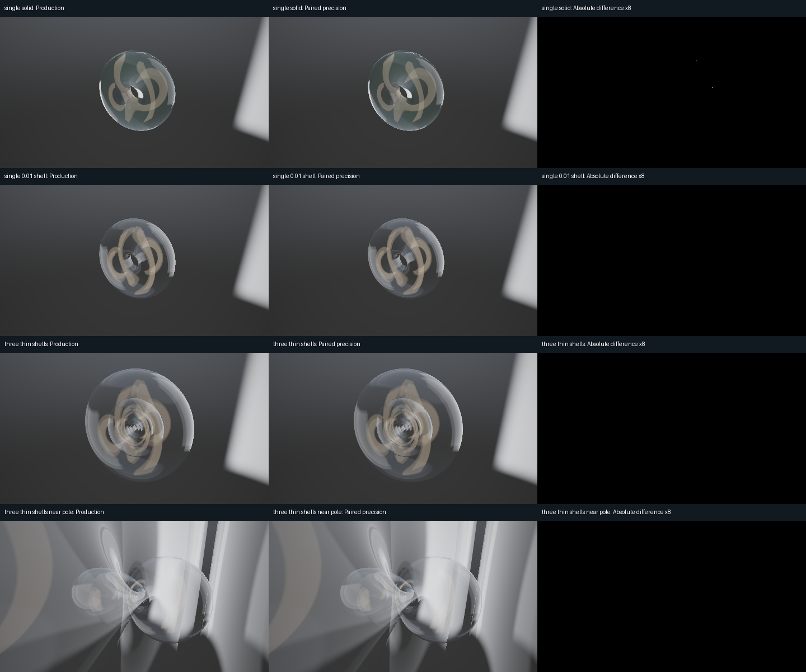

# Higher precision in WebGL: accurate, substantially slower

28 November 2026, hopf-observatory, Apple M3 Pro / Chrome 158 / ANGLE Metal.
The experimental browser renderer removes **all 123 browser grazing failures**
in the frozen stress corpus and passes the existing optical transport suite.
It takes **4.35–7.54 times the production GPU time** in the four measured scenes.
The production default remains unchanged; the new variant is available in a
local preview.

This experiment still uses **Bernstein root isolation**. It does not test a
higher-precision Ferrari or Algorithm 1010 solver. Quartics were already
algebraically solvable; this work addresses numerical construction and
evaluation errors. The timing comparison measures the complete precision
variant, including emulation, residual checks, and additional refinement.
It does not isolate those costs or measure native hardware doubles.

## Accuracy

Every method receives the same uploaded binary32 geometry. References are the
existing independent exact-rational original-ray roots. All roots are matched
one-to-one, with no advancing origin, rendering bias, finite far cutoff, or
distance-proximity merging in the all-roots collector.

At `abs(actual-reference)/max(1,abs(reference)) <= 1e-4`:

| Corpus | Queries | Reference intersections | Production failures | Paired-precision failures |
| --- | ---: | ---: | ---: | ---: |
| Original | 867 | 1,470 | 0 | **0** |
| Full stress | 2,400 | 3,314 | 123 | **0** |
| Grazing subset of stress | 600 | 584 | 123 | **0** |

All 4,784 reference intersections across the two corpora match, without missing,
extra, or nonfinite outputs. The maximum relative-distance error is `8.967e-8`
on the original corpus, `2.163e-7` on stress, and `5.773e-8` on the grazing
subset. Both complete corpora also pass at `1e-6`. At `1e-7`, the original
corpus passes and 36 stress queries fail on the tighter distance requirement.
Final coordinates and returned distances are still binary32.

The baseline's **123** failures are from the fresh browser run. The previous
CPU experiment used the **109** native failures; those counts refer to
different backends and are not interchangeable. The new implementation also
passes all 491 queries that passed the earlier native grazing test.

The raw paired construction/float isolation output recovers every reference
intersection but adds five false stationary candidates. Higher-precision
homogeneous refinement and residual acceptance remove those five. All raw
and refined records remain in [roots-all.json](results/roots-all.json).

## Optical checks and the close-contact regression

Both production and the final candidate pass the unchanged browser suite:

| Check | Passed |
| --- | ---: |
| Thin crossing sequences | 31/31 |
| Refraction paths | 36/36, including 392 interfaces |
| Index-one optics | 31/31 |
| Solid queries | 625/625 |
| Shell queries | 403/403 |
| Multi-object scene queries | 133/133 |
| Complete fragment checks | 8/8 |

An intermediate candidate failed one shell case: `t=5`, width `0.5`,
`XW=85.25`, ray 0. Exact arithmetic confirmed a genuine pair of intersections
about **2.233e-9** apart near distance `5.008992`; float32 spacing there is
**4.768e-7**. The stricter residual check exposed insufficient chart-root
refinement after the original 25 bisections. The candidate now allows up to
48 bisections, stopping at float stagnation, followed by up to four guarded
Newton steps. It retains the contact at the available output resolution.

[The focused exact check](results/close-contact.json) verifies every nearest
intersection and terminal miss on the captured incoming rays. The test
expectation and tolerance were not relaxed. The intermediate failure, its
source snapshots and exact diagnosis remain under `trials/refined/`.

## Rendering cost

GPU elapsed time, 1280×720, 24 interactions, same four scene uniforms:

| Scene | Production median | Paired precision median | Time ratio |
| --- | ---: | ---: | ---: |
| Single solid | 4.97 ms | 22.23 ms | 4.48× |
| Single 0.01° shell | 8.89 ms | 38.71 ms | 4.35× |
| Three thin shells | 28.23 ms | 212.75 ms | 7.54× |
| Three shells near the pole | 79.36 ms | 559.90 ms | 7.05× |

Each cell contains 30 measured frames from three alternating-order blocks,
with five warmups per block. Every draw has its own elapsed GPU query and
synchronous one-pixel completion readback. Compilation, warmups, polling,
full-image readback, UI and vsync are excluded. Disjoint results are rejected.
Only one experimental GPU task ran during timing.

Block variation is visible, but the slowdown occurs in every paired block.
The [raw samples](results/benchmark.json) and [analysis](results/analysis.json)
retain medians, quartiles, block ratios and completion wall times. These are
offscreen completed-frame costs on one stack, not displayed FPS or a native
FP64 throughput comparison. The benchmark verifies that its full-renderer
shader hashes match the root and optical correctness runs.

The likely major cost is the additional software arithmetic, but this run
does **not** attribute a measured percentage to emulation, compiler barriers,
longer isolation, or stronger refinement separately. Testing selective
precision or a higher-precision algebraic backend is future work.

## What changed

`paired.glsl` represents sensitive scalars as `high + low` pairs of binary32
values. Error-recovering sums and split products preserve extra significand
bits. A runtime-opaque integer XOR on float bit patterns forces intermediate
rounding and prevents algebraic reassociation across the recovery steps.
`uPrecisionGuard` must be zero, its WebGL initialization default. Eight actual
GPU arithmetic fixtures check cancellation, product residuals, division and
separated scales before any root tests run.

The paired calculations cover ray recentering, homogeneous chart vectors,
matrix subtraction, Bernstein coefficient construction, homogeneous residuals,
derivatives, and ray-distance conversion. The chart scale can be binary32
because any shared positive scale gives a valid parameterization. The
constructed Bernstein coefficients are rounded to binary32 for the existing
isolator; candidates are then refined against the paired homogeneous form.
Candidate acceptance uses `1e-12*M + 8*2^-23*abs(x*g')`, accounting heuristically
for form arithmetic and float coordinate rounding. It is not an interval
certificate or a completeness proof.

`renderer.mjs` assembles this replacement without editing `web/shader.js`.
Object traversal, normals, media, optics, offsets and interaction budgets stay
as in production. The only isolator change is the larger bisection budget with
stagnation stopping. The float-pair technique is standard extended-precision
arithmetic; see the [luma.gl precision guide](https://luma.gl/docs/api-guide/shaders/gpu-floating-point-precision)
for the distinction from native binary64. No luma.gl code or dependency was
copied into this implementation.

This representation retains binary32 exponent limits and does not supply all
binary64 significand bits. Extreme range, subnormals, exact degeneracies,
compiler behavior on other GPUs, input quantization, and finite optical
offsets remain limits. The tested corpus is reused during development and
does not establish an independent general failure rate.

## Images and preview

Outside timing, both renderers were captured at 480×270 in material, normal
and depth modes. All shell comparisons differ by at most one RGB8 code value;
the single-shell images are identical. The single solid has five differing
material pixels, two over three codes, with a maximum channel difference of
76. Those two pixels were not independently traced in this experiment, so
these comparisons establish close agreement, not a physically exact image.
All 24 lossless captures and their hashes are retained.



Start the original application with the experimental shader served in memory:

```sh
node research/diagnostics/browser-precision/serve.mjs
```

Open [the higher-precision preview](http://127.0.0.1:8766/) or
[the production baseline](http://127.0.0.1:8766/baseline/). Each has a link to
the other. No production files are rewritten. The default port can be changed
with `HOPF_PRECISION_PORT`.

## Reproduce and verify

Use the existing project Node/Python dependencies. Hardware Chrome and GPU
access are required for the Node graphics commands; run them sequentially:

```sh
node research/diagnostics/browser-precision/run-roots.mjs --all
.venv/bin/python research/diagnostics/browser-precision/analyze.py --roots-only
node research/diagnostics/browser-precision/run-transport.mjs --variant=production
node research/diagnostics/browser-precision/run-transport.mjs --variant=paired
node research/diagnostics/browser-precision/diagnose-transport.mjs
.venv/bin/python research/diagnostics/browser-precision/analyze-transport-diagnostic.py
node research/diagnostics/browser-precision/benchmark.mjs
.venv/bin/python research/diagnostics/browser-precision/analyze.py
node research/diagnostics/browser-precision/smoke-preview.mjs
.venv/bin/python research/diagnostics/browser-precision/verify-preservation.py
```

The analyzers verify source/input hashes, complete corpus membership, root
matching, correctness-to-timing shader identity, scene uniforms, sample counts
and image hashes. Preservation checks cover 75 paths from the previous CPU
experiment; the production shader and prior numerical evidence remain
unchanged. The previously recorded `web/technical-note.html` documentation
mismatch against the older grazing manifest is explicitly retained.

`trials/construction/` and `results/trial-construction.json` retain the first
construction-only experiment. `trials/refined/` retains the intermediate
25-bisection candidate and its shell regression. Their original path hashes
are historical; the final reports are checked against current sources.
`PROTOCOL.md` records the scope before implementation. Numerical development
changes and their motivating failures are documented above.
