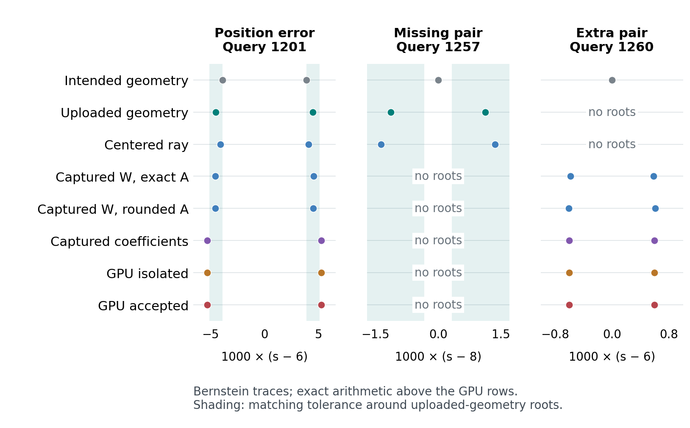

# Diagnosing the frozen grazing failures

This is a **post-hoc diagnostic**, using all 600 grazing queries from the original seed-20261121 stress corpus. It does not replace that corpus, its results, or the production renderer. The [protocol](PROTOCOL.md) was written before diagnostic execution; [frozen-manifest.json](frozen-manifest.json) protects 62 existing source/result files through 65 recorded paths. The new capture and analysis are in [results/](results/).

## Finding

**Exact isolation of the captured GPU coefficients fails against the original represented-geometry reference on exactly the same 109 query IDs as the GPU solvers.** This holds for Bernstein and both Yuksel variants at the existing relative-distance tolerance `1e-4`. The failure categories also agree: 40 output-count shortfalls, 34 excesses and 35 equal-count position failures. An exact root finder applied to those coefficients cannot recover the original ray's root set at that tolerance.

This separates post-upload construction error from the previously measured intended-to-float32 input changes. The reference here is the exact polynomial of the **already uploaded float32 inputs**, not the ideal geometry. The diagnostic does not explain away the original 109 failures as input quantization.

| Polynomial/output compared with uploaded-geometry roots | Failed queries / 600 | Of the final 109, already discrepant |
|---|---:|---:|
| Exact reconstructed centered ray | 39 | 34 |
| Captured homogeneous vectors, exact `P - c I` | 103 | 88 |
| Captured vectors and rounded matrix subtraction | 106 | 90 |
| Exact roots of captured Bernstein/power coefficients | 109 | 109 |
| GPU candidates before refinement | 109 | 109 |
| Refined candidates before residual filtering | 109 | 109 |
| Final accepted GPU roots | 109 | 109 |

The counts and failed-ID sets at each row agree across the three methods on this corpus. Intermediate discrepancy sets are **not nested**: errors can cancel downstream. These are controlled exact-arithmetic stage substitutions, not additive error budgets or a unique attribution to individual floating-point instructions.

## What was captured and solved

The native helper executes the frozen GLSL bodies on Apple M3 Pro, OpenGL 4.1 Metal 90.5. Separate diagnostic entry points read back `k`, `C`, `L`, the homogeneous vectors, the rounded matrix `P - c I`, both coefficient bases, isolated/refined candidates and acceptance decisions. SymPy 1.14.0 expands the captured binary floats as exact rationals and isolates roots with rational coordinate brackets no wider than `1e-40`. The report retains coordinate brackets, mapped ray-distance brackets, multiplicities, coefficients and every case's stage root sets. It reuses the independent original-ray polynomial expansion and maximum-cardinality matching, not the production root solver.

The reconstructed-ray stage uses the captured `C` and `k`, with exact arithmetic on `p(s) = C + (s + k)d`. The next stage uses the captured chart vectors but exact subtraction in `P - c I`; the third also uses the captured float32 subtraction. The coefficient stage isolates the actual read-back Bernstein or power polynomial. Each chart's domains, finite-infinity endpoint and forward-ray selection are respected. Counts are distinct roots, not algebraic multiplicities.

All 3,600 unchanged replay outputs (600 queries × three methods × raw/refined) reproduce the frozen float hit sets. The instrumented collector also reproduces all 3,600. The individual chart probes aggregate identically in 3,597 comparisons. The other three differ by one ULP, on queries 1222 and 1633; none changes a failed-query classification at `1e-4`. These discrepancies remain in the capture and analysis. Probe extraction can perturb compiler arithmetic; the evidence supports the measured stage behavior, not instruction-level equivalence.

## Downstream controls

- Removing Bernstein's internal proximity consolidation, while retaining exact-duplicate handling, changes **no raw or refined output** on any of the 600 queries.
- The residual filter removes **zero** forward finite candidates in these traces. Its acceptance does not imply that a candidate belongs to the original ray polynomial.
- Refinement changes 63 Bernstein candidate positions and 68 in each Yuksel variant, but changes no principal-tolerance failed-query classifications. Individual matched-root counts do change.
- Against the exact roots of the captured coefficients, both Yuksel variants match all 600 queries. Bernstein differs on query **1311**: the captured polynomial has no real chart roots, but its near-zero stationary rule returns `s = 4` with computed residual approximately `6.52e-10`. The represented original ray has roots near `3.99965773` and `4.00034211`. The extra candidate matches one of those roots at the study tolerance while leaving the other missing. It explains the one-root difference in the original aggregate counts without establishing superior completeness.

## Representative failures

The figure uses the original report's first representative in each category, fixed before this diagnostic: 1201 (position), 1257 (shortfall), and 1260 (excess).



- **1201:** represented roots near `5.99552198` and `6.00447774`; exact roots of the captured Bernstein coefficients near `5.99474291` and `6.00525709`. Isolation closely follows the displaced coefficient roots.
- **1257:** the represented ray has a pair near `7.99887110` and `8.00112839`. Exact solving after homogeneous-vector capture already has no roots, and all three methods return none.
- **1260:** the represented ray has no real intersections. Captured chart construction creates a pair near `5.99941690` and `6.00058371`; coefficient construction moves it further, and all three solvers return the extra pair.

## Interpretation and limits

The useful implementation lesson is to assess polynomial construction against the original represented ray before comparing root finders. For these cases, improving root isolation alone cannot fix the coefficient mismatch. The evidence motivates testing higher-precision construction or refinement evaluated from the original ray inputs; neither remedy is implemented or validated here. This remains one deliberately grazing distribution on one GPU/compiler stack. It establishes no general failure rate, new solver, speed result or universal explanation for tangencies.

## Reproduce

From the project root, with the existing pinned `research/requirements.txt` environment:

```sh
node research/diagnostics/grazing/run.mjs
.venv/bin/python research/diagnostics/grazing/analyze.py
.venv/bin/python research/diagnostics/grazing/plot.py
.venv/bin/python research/diagnostics/grazing/test_diagnostic.py
```

The first command needs macOS graphics-driver access. The other commands analyze the supplied capture on the CPU. Each analysis verifies source/input hashes and the frozen manifest; all output paths are local to this diagnostic. Five analytic tests check degree-elevated Bernstein conversion, double-contact multiplicity, reciprocal infinity handling, chart ownership/origin exclusion, a homogeneous ray identity with a non-unit direction, and distinct-root accounting.
