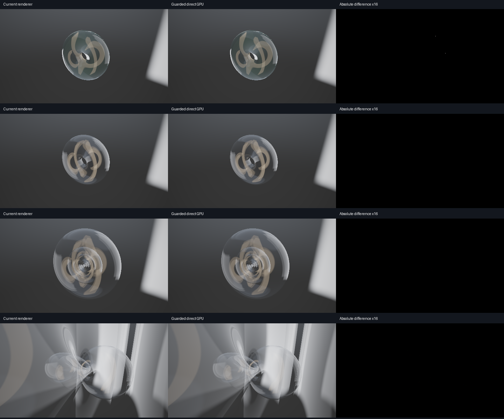

# Guarded direct quartics on the GPU

28 November 2026, hopf-observatory. A WebGL2 fragment-shader implementation of
direct Ferrari/Cardano formulas, with guarded arithmetic and a higher-precision
direct path. Intersections run entirely on the GPU. No polynomial-root search,
Newton/Halley polishing, residual rejection, or iterative fallback is used.

The application can run this solver through the local preview below. The
production shader and prior experiments are preserved. This is a tested
experimental renderer, not a proof of correctness for every possible quartic.

## Implementation

`renderer.mjs` inserts the candidate and replaces only `intersection()`. The
camera, normals, scene traversal, materials, optical paths, interaction budgets,
environment and display calculations remain the production shader's code.

`intersection.glsl` constructs a centered, scaled homogeneous ray polynomial
from the original uploaded binary32 geometry, using paired binary32 arithmetic.
The small low-order components are preserved during coefficient construction;
making only the final solver more accurate would not recover lost coefficients.

`solver.glsl.in` generates both ordinary float and paired-float versions of the
same direct algorithm. The guard checks cancellation in float addition and
subtraction (a result below 2% of the sum of input magnitudes), small discriminants
and depressed odd coefficients (128 binary32 epsilons), and nonfinite results.
An uncertain float calculation is discarded and the complete direct formula is
reevaluated using the retained higher-precision coefficients. This is a precision
switch, not an iterative root solve. The thresholds are practical guards, not
certified forward-error bounds or completeness certificates.

The formula handles exact zeros and degree loss, biquadratics, and repeated-root
branches explicitly. It uses power-of-two normalization and near-zero root
scaling, bounded coordinate translations, optional reciprocal coordinates, and
stable quadratic extraction. Factor constants are recovered through their product
when subtraction would lose precision. Small cubic roots are also recovered
through product identities, including the conjugate pair's positive product in
Cardano's one-real-root branch. The positivity test is a sufficient algebraic
test for no real roots, with a rounding margin.

Paired arithmetic reuses the earlier tested float-pair operations and runtime
rounding barrier. `uPrecisionGuard` must remain zero. This representation has
roughly twice the significand precision of float, with the exponent range of
float; it is not IEEE binary64. `elementary.glsl` evaluates sqrt, cbrt, and
trigonometric expressions with fixed arithmetic expansions around hardware
function values. These computations evaluate elementary functions appearing in
the closed-form solution; they do not refine a root of the input polynomial.

The formula is adapted from the native experiment's Boost-attributed solver.
The attribution is retained in the template and `LICENSE_1_0.txt`. The new cubic
product identities and shader-specific arithmetic guards are described above.

## Correctness

The unchanged 867 original rays and 2,400 stress rays are checked against their
independent exact-rational references, matching every distinct positive root.
There is no advancing origin, distance-proximity merging, far cutoff or residual
filter. Only identical binary32 outputs are collapsed. The uploaded geometry is
the reference target, not unrounded intended geometry.

At the original relative-distance tolerance of 1e-4, the guarded direct candidate
passes all 3,267 queries and all 4,784 intersections. The freshly measured current
renderer passes the original corpus and fails 123 stress queries. At 1e-6, the
guarded candidate fails 2 original and 23 stress queries on distance accuracy;
the forced paired-direct control passes every query through 1e-7. Thus the float
fast path has a measurable accuracy tradeoff even when it passes the standard
criterion. Neither variant is claimed universally complete.

Both direct variants pass all 54 polynomial fixtures against exact isolation of
their actual uploaded coefficients. The guarded renderer and the baseline pass
the unchanged optical suite: 31 thin crossing sequences; 36 refraction paths
with 392 interfaces; 31 index-one checks; 625 solid, 403 shell and 133 scene cases;
and eight complete-fragment checks.

Higher precision is selected on 735/867 original and 2,008/2,400 stress queries,
or 84.0% overall. These are corpus proportions, not measured frame proportions.
The initial narrower guard missed seven queries. Its source and failures are
preserved in `trials/initial/`; the test cases and tolerances were not changed.

Sixteen full-image comparisons cover four scenes in material/normal/depth modes
at 480x270 and material mode at 1280x720. Every normal/depth comparison differs
by at most one RGB8 code. Shell material images differ by at most one code at
480x270 and two at 1280x720. The solid has two pixels over three codes at 480x270
and eleven at 1280x720, with maximum differences 76 and 80 respectively.
All 313 actual scene queries along those 13 pixel paths pass independent exact
root checks at 1e-4, with maximum relative error 1.91e-6. One exceeds 1e-6.
The trace instrumentation reproduces the original float colors exactly, and
those colors quantize to the captured image bytes. No wrong nearest hit or
terminal miss was found on these paths. This supports round-off sensitivity in
repeated reflection paths; it does not establish an exact physical color.



## Complete-frame performance

Apple M3 Pro, Chrome 158, WebGL2 / ANGLE Metal. Medians of 30 measured completed
frames per scene and variant (240 total). All frames are 1280x720 with the same
24-interaction budget and scene uniforms. Values below include one-pixel
synchronous completion readback.

| Scene | Current renderer | Guarded direct GPU | Direct/current |
| --- | ---: | ---: | ---: |
| single solid | 5.10 ms | 14.45 ms | 2.83x |
| single 0.01 shell | 9.85 ms | 46.15 ms | 4.69x |
| three thin shells | 32.95 ms | 185.55 ms | 5.63x |
| three thin shells near pole | 93.10 ms | 496.65 ms | 5.33x |

The corresponding elapsed-GPU medians (excluding the completion readback) are
4.65/13.91 ms, 9.36/45.21 ms, 32.24/184.97 ms, 92.36/495.72 ms for current/direct in table order. The candidate is slower in every paired
block, although the baseline's three-shell timing varies substantially between
blocks. Raw samples and block medians are in [benchmark.json](results/benchmark.json).

**Direct GPU solving is working on the tested workload. This implementation is
2.83–5.63 times slower than the current renderer in completed-frame time.** The
measurement includes coefficient precision, conservative guards, duplicate work
on precision escalation, and software elementary functions. It does not isolate
those costs or establish that direct formulas are inherently slower. No change
to an iterative or CPU implementation is proposed by this result.

## Preview and reproduction

From the repository root, with the existing Node and Python dependencies:

```sh
node research/diagnostics/guarded-direct/serve.mjs
```

Open [the direct GPU preview](http://127.0.0.1:8767/) or
[the current renderer](http://127.0.0.1:8767/baseline/). `HOPF_DIRECT_PORT` overrides
the port. The server substitutes the shader in memory; it does not rewrite the
application. A browser with WebGL2 is required. Only Chrome/ANGLE Metal on the
test Mac has been validated; cross-device accuracy and compilation are untested.

Run GPU commands sequentially with hardware Chrome/graphics-driver access:

```sh
node research/diagnostics/guarded-direct/run-roots.mjs
.venv/bin/python research/diagnostics/guarded-direct/analyze-roots.py
node research/diagnostics/guarded-direct/run-fixtures.mjs
.venv/bin/python research/diagnostics/guarded-direct/analyze-fixtures.py
node research/diagnostics/guarded-direct/run-transport.mjs --variant=direct
node research/diagnostics/guarded-direct/run-transport.mjs --variant=production
node research/diagnostics/guarded-direct/capture.mjs
.venv/bin/python research/diagnostics/guarded-direct/analyze-images.py
node research/diagnostics/guarded-direct/probe-pixels.mjs
.venv/bin/python research/diagnostics/guarded-direct/check-pixels.py
node research/diagnostics/guarded-direct/benchmark.mjs
node research/diagnostics/guarded-direct/smoke-preview.mjs
.venv/bin/python research/diagnostics/guarded-direct/verify.py
```

The protocol fixes four 1280x720 scenes and the 24-interaction budget, with three
alternating-order blocks per variant and scene, five warmups and ten measured
frames per block. Each measured draw has an elapsed GPU query and synchronous
one-pixel readback. Completion times include that readback. Compilation, warmup,
query polling, full-image capture, UI and vsync are excluded. These are completed
offscreen frames, not displayed FPS. The benchmark verifies that it uses the
same shader as the correctness checks.
