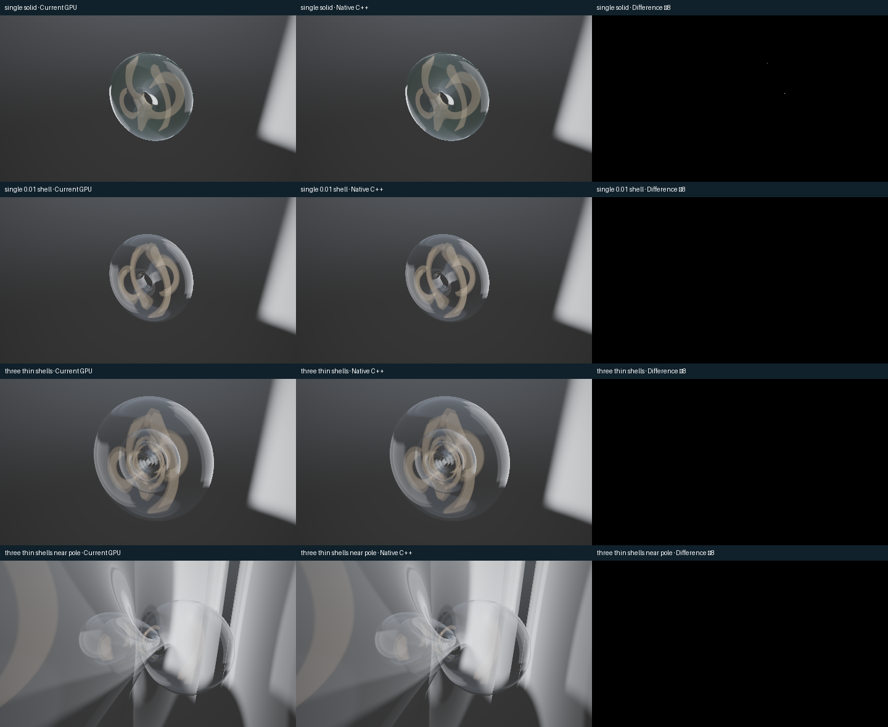

# C++ renderer: accurate complete frames, slower than the current GPU renderer

28 November 2026, Apple M3 Pro, 12 CPU workers, Apple Clang 17, Boost 1.90,
SDL Metal and Chrome 158 / ANGLE Metal.

The native C++ renderer is built and produces complete images using direct
quartic formulas. It passes the existing root and optical tests, and its
rendered images closely agree with the current WebGL renderer. **At 1280×720,
the current GPU renderer is 15–21 times faster in completed-frame wall time.**
The earlier 12× improvement compared two CPU root solvers; it was not a
GPU-renderer speedup. This prototype is useful as a native precision/reference
renderer, but these measurements do not justify replacing the interactive
GPU renderer with this CPU implementation.

## Complete-frame performance

Same scene uniforms, camera, resolution, materials, 24 primary interactions
and four secondary-reflection interactions. Values below are medians of nine
measured frames per backend, from three alternating-order blocks. Each block
has one warmup and three measured frames. Native rendering and GPU rendering
run sequentially.

| Scene | C++ completed frame | Current GPU completed frame | C++ / GPU |
| --- | ---: | ---: | ---: |
| Single solid | 114.99 ms | 5.40 ms | 21.29× |
| Single 0.01° shell | 191.63 ms | 9.30 ms | 20.61× |
| Three thin shells | 615.30 ms | 40.80 ms | 15.08× |
| Three thin shells near the pole | 1,786.73 ms | 90.80 ms | 19.68× |

Native completed-frame time includes worker dispatch, every camera ray,
intersection, optical path, lighting, tone mapping, conversion to RGBA8,
upload to an SDL Metal texture, drawing to a render target and a one-pixel
completion readback. GPU completed-frame time is draw plus synchronous
one-pixel readback. Every GPU frame also has an elapsed query; disjoint or
incomplete samples reject the run. These are **offscreen frame costs**, not
displayed FPS: vsync, UI, compilation, parsing, file output, process IPC and
full-image capture are outside timing. SDL target allocation and thread
creation are outside the measured frames too.

| Scene | C++ compute only | C++ upload/completion stage | GPU elapsed query | One CPU worker, compute only |
| --- | ---: | ---: | ---: | ---: |
| Single solid | 114.12 ms | 1.15 ms | 4.94 ms | 872.33 ms |
| Single thin shell | 190.55 ms | 1.13 ms | 8.82 ms | 1,588.68 ms |
| Three thin shells | 613.52 ms | 1.16 ms | 40.10 ms | 5,020.96 ms |
| Shells near the pole | 1,782.99 ms | 3.68 ms | 90.21 ms | 16,361.98 ms |

Stage medians are calculated independently and need not sum to the median
total. The one-worker column is a single completed control frame per scene,
not a repeated timing estimate. Its image checksum equals the 12-worker
image in every scene. All repeated native-frame checksums also agree with
the correctness captures: no cached image is substituted for computation.

Block variation is retained in [benchmark.json](results/benchmark.json).
For example, native solid block medians range from 98.58 to 121.13 ms, while
GPU block medians range from 5.3 to 7.9 ms. The native renderer loses in every
scene and every block. This is one machine and a scalar CPU implementation
with thread parallelism, not a claim about the best achievable C++ renderer.

## What was implemented

The source is in [native/](../../../native/README.md). It uses portable C++17,
Boost headers, persistent 16×16 tile workers and optional SDL3 display. CMake
builds it; Node generates the shared optical code and drives the test process.
A separate build with SDL disabled produced a byte-identical frame with two
workers. Only macOS has actually been compiled and tested; Windows/Linux
packaging has not been verified.

The production shader owns the optical behavior. A checked generator translates
its scalar/vector syntax into C++, preserving its normals, material priorities,
shell transitions, offsets, Fresnel/Snell calculations, absorption, lighting,
reflection budgets, tone mapping and vignette. The intersection routine is
replaced by the native direct solver. Camera and optical arithmetic use native
binary64; input uniforms are first rounded to the same binary32 values uploaded
to WebGL. The production web default and prior experiments are unchanged.

The native viewer displays a completed still. Full application controls and
imported environment images are not ported; these benchmark scenes use the
shared procedural studio environment. The neutral environment texture is
supported by the test interface.

## Formula guards and precision

The fixed algebraic ray corpus passed in ordinary doubles, but complete frames
generate additional rays. Two issues emerged and were corrected:

1. Some distant misses produced a numerically degenerate cubic resolvent.
   Independent exact-rational checks confirmed **zero real roots in all 128
   captured polynomials**. A sufficient algebraic positivity test now handles
   that case before Ferrari factorization.
2. At 1280×720, two shell pixels exposed **three wrong boundary queries** from
   cancellation inside the direct formula. The original rays, exact roots,
   incorrect outputs, source snapshot and images remain in
   [trials/binary64](trials/binary64/) and the diagnostic results.

The final renderer detects uncertain discriminant signs and severe cancellation
inside Cardano's expression. It then reconstructs that original ray/surface
query at **113 bits**, or **256 bits** if still flagged. Every stage uses the
direct formulas. There is no iterative root search, Newton/Halley polishing,
residual filtering, or silent removal of small leading coefficients. This is
the practical distinction between checking an exact special case and trusting
a sign that may have been damaged by floating-point cancellation.

| Scene | Queries escalated to 113 bits per frame | Further escalations to 256 bits |
| --- | ---: | ---: |
| Single solid | 298 | 0 |
| Single thin shell | 749 | 0 |
| Three thin shells | 5,787 | 1 |
| Shells near the pole | 10,200 | 0 |

All escalation costs are included in the timings. The guards and their constants
are documented in the [protocol](PROTOCOL.md). They are practical conditioning
checks, not certified interval bounds or a universal completeness proof.
Strict binary64 and forced higher-precision modes remain available for diagnosis.

## Validation and images

- All **3,267 original/stress ray queries** pass one-to-one matching against
  their independent exact references at relative-distance tolerance 1e-8.
- The unchanged optical expectations pass: **31 thin-crossing cases, 36
  refraction paths with 392 interfaces, 31 index-one checks, 625 solid cases,
  403 shell cases, 133 scene cases and eight complete fragment checks**.
- Sixteen CPU/GPU image comparisons cover material, normal and depth modes at
  480×270, plus material images at the timed 1280×720 resolution. There are no
  invalid root results or nonfinite native colours.
- **Every shell image agrees within one RGB8 code value per channel**, at both
  resolutions. Every 480×270 normal/depth image also agrees within one code.
- The solid has two pixels differing by more than three codes at 480×270 and
  seven at 1280×720; the maximum differences are 76 and 58. All these outliers,
  plus the two repaired shell pixels, have the **same native RGBA8 result when
  intersections are forced to 256 bits**.
- **314 nearest-boundary queries** from those pixel paths were independently
  checked using exact-rational original-ray polynomials, with zero failures
  at the recorded 1e-6 distance criterion. The 104 queries from the two original
  erroneous paths also replay correctly after the fix. This checks those
  paths, not every possible future ray or every approximation in the optics.



[validation.json](results/validation.json) records all pixel statistics and
coordinates. [outlier-final.json](results/outlier-final.json) retains the wider-
precision replays; [exact-outliers-final.json](results/exact-outliers-final.json)
retains the independent references. Raw images are gzip-compressed RGBA8,
bottom row first.

## Reproduce and verify

From the repository root, using the existing Node/Python dependencies, Boost
and optional SDL3:

```sh
cmake -S native -B native/build -DCMAKE_BUILD_TYPE=Release -DCMAKE_PREFIX_PATH=/opt/homebrew
cmake --build native/build -j 4
node research/diagnostics/native-renderer/prepare.mjs
node research/diagnostics/native-renderer/roots.mjs
node research/diagnostics/native-renderer/transport.mjs
node research/diagnostics/native-renderer/benchmark.mjs --capture
.venv/bin/python research/diagnostics/native-renderer/analyze.py
node research/diagnostics/native-renderer/probe-outliers.mjs
.venv/bin/python research/diagnostics/native-renderer/diagnose.py
node research/diagnostics/native-renderer/benchmark.mjs
.venv/bin/python research/diagnostics/native-renderer/verify.py
.venv/bin/python research/diagnostics/native-renderer/check-headless.py
```

Hardware Chrome and SDL graphics access are required for the frame comparison.
The verifier checks source/executable identity across correctness and timing,
root matches, all image statistics, all 72 measured frames, deterministic
checksums, exact outlier reports, the archived first implementation, and 81
protected paths from the previous algebraic experiment. The inherited
generated-documentation mismatch remains recorded in that prior evidence;
unrelated working-tree edits are untouched.
